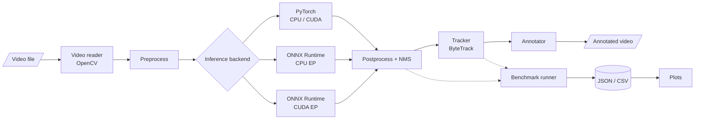

# EdgeVision — GPU-Accelerated Real-Time Perception Engine


> [!IMPORTANT]
> **This repository is an initial scaffold of an ongoing personal project.**
> No detection, tracking, ONNX export, GPU execution, benchmarking, or tests are implemented yet, and **no benchmark results have been recorded**. Everything described below as *planned* is the design target, not existing functionality.

## Overview

EdgeVision is an ongoing computer vision and performance-engineering project focused on building a video perception pipeline and evaluating inference performance across PyTorch and ONNX Runtime. The project aims to investigate the trade-offs between inference latency, throughput, and detection quality under reproducible benchmarking conditions.

### Motivation

Choosing an inference runtime is an engineering decision that should rest on measurements, yet runtime comparisons are easy to get wrong: warm-up iterations leak into averages, asynchronous CUDA execution is timed without synchronization, end-to-end pipeline speed is reported as pure model speed, and single best-case runs stand in for typical behaviour. EdgeVision is being built to answer a narrow question carefully — *for the same model, weights, and frames, how do PyTorch and ONNX Runtime compare on latency, throughput, and output agreement, on CPU and (where available) GPU?* — with a methodology that makes every result traceable to its configuration and hardware.

## Project status

| Capability | Planned | Implemented | Benchmarked |
|------------|:-------:|:-----------:|:-----------:|
| Video input (OpenCV, prerecorded files) | ✅ | — | — |
| Object detection — PyTorch backend | ✅ | — | — |
| ONNX export and numerical validation | ✅ | — | — |
| Object detection — ONNX Runtime CPU | ✅ | — | — |
| Object detection — ONNX Runtime CUDA (when available) | ✅ | — | — |
| Multi-object tracking (ByteTrack) | ✅ | — | — |
| Annotated output video | ✅ | — | — |
| Latency / throughput benchmark runner | ✅ | — | — |
| Detection-quality evaluation (ground truth) | ✅ | — | — |
| Automated test suite | ✅ | — | — |

- **Planned** — described in the project specification; not yet built.
- **Implemented** — exists in this repository and is covered by passing tests.
- **Benchmarked** — measured, with results and configuration recorded in [`docs/experiment_log.md`](docs/experiment_log.md).

**What exists today:** the repository layout, packaging metadata, a draft experiment configuration, a `.gitignore` that keeps weights/videos/results out of Git, and design documents for the architecture and benchmarking methodology.

## Intended scope

- Lightweight pretrained object detection (initially YOLOv8n) on recorded video
- Multi-object tracking with persistent track IDs
- PyTorch and ONNX Runtime inference backends driven through one interface
- CPU as a first-class mode, with optional NVIDIA GPU execution when hardware is actually available
- Repeatable latency and throughput benchmarking with machine-readable results (JSON/CSV) and plots
- Detection-quality evaluation when suitable ground-truth annotations are available

**Out of scope for now:** live camera input, production deployment, and real-time guarantees on any particular hardware.

## Planned architecture



Detection and tracking are deliberately separate stages so that detection-only benchmarks are possible. Every backend will emit the same detection record — frame index, `xyxy` box in source-frame pixels, confidence, class ID, class name — so tracking and evaluation do not depend on which runtime produced the detections. Component responsibilities are described in [`docs/architecture.md`](docs/architecture.md).

## Intended technology stack

| Area | Tools |
|------|-------|
| Language | Python 3.11 |
| Detection model | Ultralytics YOLO (YOLOv8n to start) |
| Deep learning framework | PyTorch |
| Model interchange | ONNX |
| Inference runtime | ONNX Runtime (CPU EP; CUDA EP when available) |
| Tracking | ByteTrack (existing implementation) |
| Video I/O | OpenCV |
| Data and analysis | NumPy, Pandas |
| Visualization | Matplotlib |
| Configuration | PyYAML |
| Testing | pytest |
| Compute | Local CPU; Google Colab or Kaggle GPUs when available |

TensorRT is an optional stretch goal, not a dependency.

## Repository structure

Current contents:

```text
edgevision/
├── README.md
├── pyproject.toml           # package metadata and planned dependencies
├── .gitignore
├── configs/
│   └── default.yaml         # draft experiment configuration (not yet consumed)
├── src/
│   └── edgevision/
│       └── __init__.py      # package marker and version only
├── scripts/
│   └── README.md            # planned CLI entry points
├── tests/
│   └── README.md            # planned test coverage
├── docs/
│   ├── architecture.md      # planned components and data flow
│   ├── benchmarking.md      # planned timing methodology
│   └── experiment_log.md    # empty until experiments are run
├── data/
│   ├── README.md
│   └── input/               # local videos (git-ignored)
├── models/
│   └── README.md            # local weights and ONNX exports (git-ignored)
└── results/
    └── README.md            # benchmark outputs (git-ignored)
```

Planned modules under `src/edgevision/` (added only as they are implemented): `config`, `device`, `models/` (backend interface, PyTorch backend, ONNX backend, export), `video/` (reader, writer), `tracking/`, `benchmarks/` (timing, runner, metrics, report), `evaluation/`, and `pipeline`.

## Planned benchmark methodology

- **Two scopes, reported separately:** model-only inference, and end-to-end frame processing with the included stages (decode, preprocess, inference, postprocess, tracking, rendering) stated explicitly.
- **Phases kept apart:** model load time, warm-up time, and steady-state latency are recorded separately; load and warm-up never enter steady-state statistics.
- **Correct GPU timing:** CUDA work is synchronized before the clock is read; ONNX Runtime results state which execution provider was actually active.
- **Statistics:** mean, median, p90, p95 per run; throughput as frames ÷ measured wall-clock interval, reported separately from `1 / mean latency`.
- **Fairness:** identical weights, input resolution, thresholds, class filter, video, frame sequence, warm-up count, and frame count across backends; batch size 1 by default.
- **Repetition:** at least three runs per configuration where compute permits, with variation reported — never just the best run.
- **Quality:** precision / recall / F1 (and mAP only where the protocol supports it) against ground-truth annotations; without ground truth, only backend-agreement diagnostics, which are explicitly **not** accuracy.
- **Traceability:** every result records its config, git commit, hardware, OS, library versions, and execution provider.

Details: [`docs/benchmarking.md`](docs/benchmarking.md).

## Setup and usage

> [!NOTE]
> **Forthcoming.** Only cloning works today. The commands below show the intended interface and will be finalized when each part is implemented.

```bash
git clone https://github.com/mukhul/edgevision.git
cd edgevision
```

Planned interface (not yet functional):

```bash
# Environment (CPU)
python3.11 -m venv .venv
source .venv/bin/activate            # Windows PowerShell: .venv\Scripts\Activate.ps1
pip install -e ".[cpu,dev]"          # GPU: ".[gpu,dev]" — onnxruntime and onnxruntime-gpu must not be installed together

# Report hardware, library versions, and ONNX Runtime execution providers
python -m edgevision.device

# Export the PyTorch model to ONNX and validate it against PyTorch outputs
python scripts/export_onnx.py

# Process a video with tracking and write an annotated output
python scripts/run_video.py --input data/input/sample.mp4 --backend pytorch --output results/annotated_pytorch.mp4

# Benchmark backends on identical frames
python scripts/benchmark.py --input data/input/sample.mp4 --backends pytorch onnx_cpu --warmup 20 --frames 300 --runs 3 --output results/benchmark

# Plot saved results
python scripts/plot_results.py --input results/benchmark --output results/plots
```

CUDA-enabled PyTorch wheels and GPU setup instructions will be documented separately once GPU execution has been verified.

## Roadmap

- [x] Initial repository scaffold and design documents
- [ ] Configuration loading and validation
- [ ] Hardware / software environment report and device selection
- [ ] Video reader with frame limit and robust error handling
- [ ] PyTorch detection backend
- [ ] Annotated video output
- [ ] Multi-object tracking with ByteTrack
- [ ] ONNX export with output-shape, finite-value, and numerical-agreement checks
- [ ] ONNX Runtime CPU backend
- [ ] Benchmark runner with JSON / CSV export
- [ ] Plot generation from saved results
- [ ] CPU-only unit and integration tests
- [ ] ONNX Runtime CUDA backend (verified execution provider)
- [ ] Detection-quality evaluation on an annotated dataset
- [ ] First recorded benchmarks (Experiments A–E in [`docs/experiment_log.md`](docs/experiment_log.md))

## Benchmark results

None yet. Results will be published in [`docs/experiment_log.md`](docs/experiment_log.md) only after they have been measured, together with the hardware, software versions, and configuration that produced them.

## Known limitations

- The repository contains no functional code yet.
- Dependencies are listed with lower bounds only and have not been installed or tested together.
- `configs/default.yaml` is a draft; its fields may change.
- Free cloud GPUs vary in model and availability, so any GPU results will apply only to the recorded hardware.
- ONNX Runtime may not be faster than PyTorch for a given model and device; the project will report whatever is observed.

## Future work

- Optional TensorRT experiments (via the ONNX Runtime TensorRT execution provider or a standalone engine)
- FP16 inference, validated against the FP32 baseline
- Batch-size experiments alongside the default batch size of 1
- ONNX Runtime I/O binding to measure the cost of host ↔ device copies
- Tracking metrics (e.g. HOTA, IDF1) once annotated multi-object tracking data is included

## License

A license has not been chosen yet. Note that Ultralytics YOLO and its pretrained weights are distributed under AGPL-3.0, which should be considered when choosing a license for this project. Model weights, datasets, and videos are not distributed in this repository.
