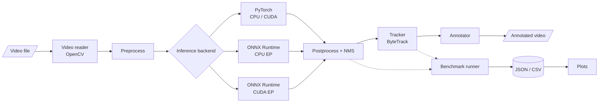

# EdgeVision — GPU-Accelerated Real-Time Perception Engine


> [!IMPORTANT]
> **This repository is in early development.**
> Only the project foundation and video input exist so far: an installable package, validated configuration loading, an environment report, and a frame-by-frame video reader. No detection, tracking, ONNX export, GPU execution, or benchmarking is implemented, and **no benchmark results have been recorded**. Everything described below as *planned* is the design target, not existing functionality.

## Overview

EdgeVision is an ongoing computer vision and performance-engineering project focused on building a video perception pipeline and evaluating inference performance across PyTorch and ONNX Runtime. The project aims to investigate the trade-offs between inference latency, throughput, and detection quality under reproducible benchmarking conditions.

### Motivation

Choosing an inference runtime is an engineering decision that should rest on measurements, yet runtime comparisons are easy to get wrong: warm-up iterations leak into averages, asynchronous CUDA execution is timed without synchronization, end-to-end pipeline speed is reported as pure model speed, and single best-case runs stand in for typical behaviour. EdgeVision is being built to answer a narrow question carefully — *for the same model, weights, and frames, how do PyTorch and ONNX Runtime compare on latency, throughput, and output agreement, on CPU and (where available) GPU?* — with a methodology that makes every result traceable to its configuration and hardware.

## Project status

| Capability | Planned | Implemented | Benchmarked |
|------------|:-------:|:-----------:|:-----------:|
| Installable package (`pip install -e ".[dev]"`) | ✅ | ✅ | n/a |
| Configuration loading and validation | ✅ | ✅ | n/a |
| Hardware / software environment report | ✅ | ✅ | n/a |
| Video input (OpenCV, prerecorded files) | ✅ | ✅ | n/a |
| Object detection — PyTorch backend | ✅ | — | — |
| ONNX export and numerical validation | ✅ | — | — |
| Object detection — ONNX Runtime CPU | ✅ | — | — |
| Object detection — ONNX Runtime CUDA (when available) | ✅ | — | — |
| Multi-object tracking (ByteTrack) | ✅ | — | — |
| Annotated output video | ✅ | — | — |
| Latency / throughput benchmark runner | ✅ | — | — |
| Detection-quality evaluation (ground truth) | ✅ | — | — |
| Tests for the pipeline, backends, and benchmarks | ✅ | — | n/a |

- **Planned** — described in the project specification; not yet built.
- **Implemented** — exists in this repository and is covered by passing tests.
- **Benchmarked** — measured, with results and configuration recorded in [`docs/experiment_log.md`](docs/experiment_log.md).

**What exists today:**

- An installable `edgevision` package (src layout) whose only required dependency is PyYAML.
- `edgevision.config`: loads `configs/default.yaml` (or any given file) into typed, immutable settings. Missing fields, wrong types, out-of-range values, unknown fields and duplicate keys are rejected, and every problem is listed with its location.
- `edgevision.device`: reports Python, OS, CPU, NVIDIA GPU hardware (via `nvidia-smi`), optional packages, PyTorch CUDA support and ONNX Runtime execution providers. It works when PyTorch and ONNX Runtime are not installed, and keeps "a GPU is present" separate from "a framework can use it".
- `edgevision.video.VideoReader`: reads a prerecorded video one frame at a time (BGR, zero-based indices), with an optional `max_frames` limit, defensive metadata handling (width, height, FPS, reported frame count, codec) and guaranteed release of the OpenCV capture. OpenCV is an optional extra (`vision`).
- `scripts/inspect_video.py`: reports a video's metadata, how many frames could actually be decoded, and why reading stopped.
- pytest tests for all of the above. They need no GPU, network, or ML packages; OpenCV is replaced by a fake in unit tests, and a few integration tests use real OpenCV on a synthetic video when it is installed.
- A `.gitignore` that keeps weights, videos and results out of Git, and design documents for the architecture and benchmarking methodology.

## Intended scope

- Lightweight pretrained object detection (initially YOLOv8n) on recorded video
- Multi-object tracking with persistent track IDs
- PyTorch and ONNX Runtime inference backends driven through one interface
- CPU as a first-class mode, with optional NVIDIA GPU execution when hardware is actually available
- Repeatable latency and throughput benchmarking with machine-readable results (JSON/CSV) and plots
- Detection-quality evaluation when suitable ground-truth annotations are available

**Out of scope for now:** live camera input, production deployment, and real-time guarantees on any particular hardware.

## Planned architecture



Detection and tracking are deliberately separate stages so that detection-only benchmarks are possible. Every backend will emit the same detection record — frame index, `xyxy` box in source-frame pixels, confidence, class ID, class name — so tracking and evaluation do not depend on which runtime produced the detections. Component responsibilities are described in [`docs/architecture.md`](docs/architecture.md).

## Intended technology stack

| Area | Tools |
|------|-------|
| Language | Python 3.11 |
| Detection model | Ultralytics YOLO (YOLOv8n to start) |
| Deep learning framework | PyTorch |
| Model interchange | ONNX |
| Inference runtime | ONNX Runtime (CPU EP; CUDA EP when available) |
| Tracking | ByteTrack (existing implementation) |
| Video I/O | OpenCV |
| Data and analysis | NumPy, Pandas |
| Visualization | Matplotlib |
| Configuration | PyYAML |
| Testing | pytest |
| Compute | Local CPU; Google Colab or Kaggle GPUs when available |

TensorRT is an optional stretch goal, not a dependency.

## Repository structure

Current contents:

```text
edgevision/
├── README.md
├── pyproject.toml           # package metadata, dependencies, pytest settings
├── .gitignore
├── configs/
│   └── default.yaml         # default experiment settings (single source of defaults)
├── src/
│   └── edgevision/
│       ├── __init__.py      # package marker and version
│       ├── config.py        # YAML loading and validation
│       ├── device.py        # environment / hardware report
│       └── video/
│           ├── __init__.py
│           └── reader.py    # frame-by-frame video reading (OpenCV)
├── scripts/
│   ├── README.md            # CLI entry points (implemented and planned)
│   └── inspect_video.py     # report video metadata and decodable frames
├── tests/
│   ├── README.md            # how to run tests; planned coverage
│   ├── test_config.py
│   ├── test_device.py
│   ├── test_inspect_video.py
│   ├── test_package.py
│   └── test_video_reader.py
├── docs/
│   ├── architecture.md      # planned components and data flow
│   ├── benchmarking.md      # planned timing methodology
│   └── experiment_log.md    # empty until experiments are run
├── data/
│   ├── README.md
│   └── input/               # local videos (git-ignored)
├── models/
│   └── README.md            # local weights and ONNX exports (git-ignored)
└── results/
    └── README.md            # benchmark outputs (git-ignored)
```

Planned modules under `src/edgevision/` (added only as they are implemented): `models/` (backend interface, PyTorch backend, ONNX backend, export), `video/writer`, `tracking/`, `benchmarks/` (timing, runner, metrics, report), `evaluation/`, and `pipeline`.

## Planned benchmark methodology

- **Two scopes, reported separately:** model-only inference, and end-to-end frame processing with the included stages (decode, preprocess, inference, postprocess, tracking, rendering) stated explicitly.
- **Phases kept apart:** model load time, warm-up time, and steady-state latency are recorded separately; load and warm-up never enter steady-state statistics.
- **Correct GPU timing:** CUDA work is synchronized before the clock is read; ONNX Runtime results state which execution provider was actually active.
- **Statistics:** mean, median, p90, p95 per run; throughput as frames ÷ measured wall-clock interval, reported separately from `1 / mean latency`.
- **Fairness:** identical weights, input resolution, thresholds, class filter, video, frame sequence, warm-up count, and frame count across backends; batch size 1 by default.
- **Repetition:** at least three runs per configuration where compute permits, with variation reported — never just the best run.
- **Quality:** precision / recall / F1 (and mAP only where the protocol supports it) against ground-truth annotations; without ground truth, only backend-agreement diagnostics, which are explicitly **not** accuracy.
- **Traceability:** every result records its config, git commit, hardware, OS, library versions, and execution provider.

Details: [`docs/benchmarking.md`](docs/benchmarking.md).

## Setup and usage

Requires Python 3.11 or newer. Run all commands from the repository root.

### Available now

Windows (PowerShell):

```powershell
git clone https://github.com/mukhul/edgevision.git
cd edgevision
py -3.11 -m venv .venv
.venv\Scripts\Activate.ps1
python -m pip install --upgrade pip
python -m pip install -e ".[dev,vision]"   # vision = OpenCV, needed for video
```

If PowerShell refuses to run `Activate.ps1`, run `Set-ExecutionPolicy -Scope CurrentUser RemoteSigned` once, or use Command Prompt with `.venv\Scripts\activate.bat`.

Linux / macOS:

```bash
git clone https://github.com/mukhul/edgevision.git
cd edgevision
python3.11 -m venv .venv
source .venv/bin/activate
python -m pip install --upgrade pip
python -m pip install -e ".[dev,vision]"   # vision = OpenCV, needed for video
```

Then:

```bash
python -m edgevision.device          # hardware, packages, CUDA support, ONNX Runtime providers
python -m edgevision.device --json   # the same report as JSON
python -m edgevision.config          # validate configs/default.yaml (or pass another path)
python -m pytest                     # run the test suite

# Report a video's metadata and how many frames can be decoded
python scripts/inspect_video.py data/input/sample.mp4
python scripts/inspect_video.py data/input/sample.mp4 --max-frames 100
```

The `vision` extra installs `opencv-python-headless` (OpenCV without GUI functions). Do not also install `opencv-python`: both provide the same `cv2` module and conflict; `python -m edgevision.device` warns if more than one OpenCV package is present. Without the `vision` extra the package and tests still work, and the video integration tests are skipped with a reason.

Reading video from Python:

```python
from edgevision.video import VideoReader

with VideoReader("data/input/sample.mp4", max_frames=100) as reader:
    print(reader.metadata)            # width, height, fps, frame_count, fourcc (None if unknown)
    for frame_index, frame in reader:  # frame: BGR uint8 array, shape (height, width, 3)
        ...
print(reader.frames_read, reader.stop_reason)  # e.g. 100 StopReason.MAX_FRAMES
```

PyTorch, ONNX Runtime and Ultralytics are **not** installed by this package yet. The environment report lists them as missing until the stages that need them add their (CPU and GPU) installation instructions.

### Planned interface

> [!NOTE]
> **Forthcoming.** These commands show the intended interface and do not work yet.

```bash
# Export the PyTorch model to ONNX and validate it against PyTorch outputs
python scripts/export_onnx.py

# Process a video with tracking and write an annotated output
python scripts/run_video.py --input data/input/sample.mp4 --backend pytorch --output results/annotated_pytorch.mp4

# Benchmark backends on identical frames
python scripts/benchmark.py --input data/input/sample.mp4 --backends pytorch onnx_cpu --warmup 20 --frames 300 --runs 3 --output results/benchmark

# Plot saved results
python scripts/plot_results.py --input results/benchmark --output results/plots
```

CUDA-enabled PyTorch wheels and GPU setup instructions will be documented separately once GPU execution has been verified.

## Roadmap

- [x] Initial repository scaffold and design documents
- [x] Installable package with a pytest setup
- [x] Configuration loading and validation
- [x] Hardware / software environment report
- [ ] Device and execution-provider selection for inference backends
- [x] Video reader with frame limit and robust error handling
- [ ] PyTorch detection backend
- [ ] Annotated video output
- [ ] Multi-object tracking with ByteTrack
- [ ] ONNX export with output-shape, finite-value, and numerical-agreement checks
- [ ] ONNX Runtime CPU backend
- [ ] Benchmark runner with JSON / CSV export
- [ ] Plot generation from saved results
- [ ] CPU-only unit and integration tests
- [ ] ONNX Runtime CUDA backend (verified execution provider)
- [ ] Detection-quality evaluation on an annotated dataset
- [ ] First recorded benchmarks (Experiments A–E in [`docs/experiment_log.md`](docs/experiment_log.md))

## Benchmark results

None yet. Results will be published in [`docs/experiment_log.md`](docs/experiment_log.md) only after they have been measured, together with the hardware, software versions, and configuration that produced them.

## Known limitations

- No perception, inference, or benchmarking code exists yet; only configuration, environment reporting, and video reading work.
- Video metadata is what the file *reports*; the frame count in particular can be missing or wrong. OpenCV signals the end of a video and an undecodable frame the same way, so a corrupt file may simply end early (the inspection command flags this when the reported count is larger).
- `configs/default.yaml` is validated but not yet used by any pipeline stage; fields may still change as those stages are built.
- The environment report shows what the installed frameworks *offer*. Whether inference really runs on a GPU will only be verified once the inference backends exist.
- Free cloud GPUs vary in model and availability, so any GPU results will apply only to the recorded hardware.
- ONNX Runtime may not be faster than PyTorch for a given model and device; the project will report whatever is observed.

## Future work

- Optional TensorRT experiments (via the ONNX Runtime TensorRT execution provider or a standalone engine)
- FP16 inference, validated against the FP32 baseline
- Batch-size experiments alongside the default batch size of 1
- ONNX Runtime I/O binding to measure the cost of host ↔ device copies
- Tracking metrics (e.g. HOTA, IDF1) once annotated multi-object tracking data is included

## License

A license has not been chosen yet. Note that Ultralytics YOLO and its pretrained weights are distributed under AGPL-3.0, which should be considered when choosing a license for this project. Model weights, datasets, and videos are not distributed in this repository.
