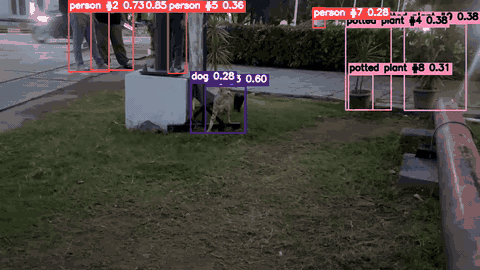
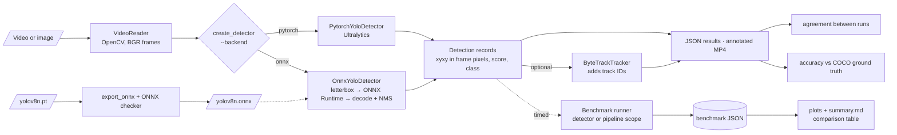
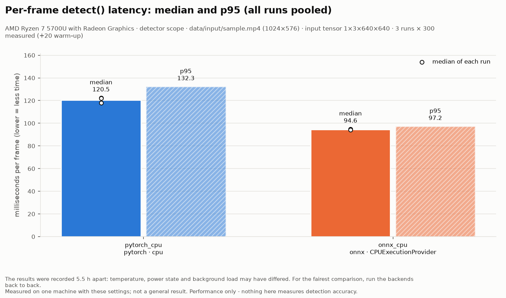
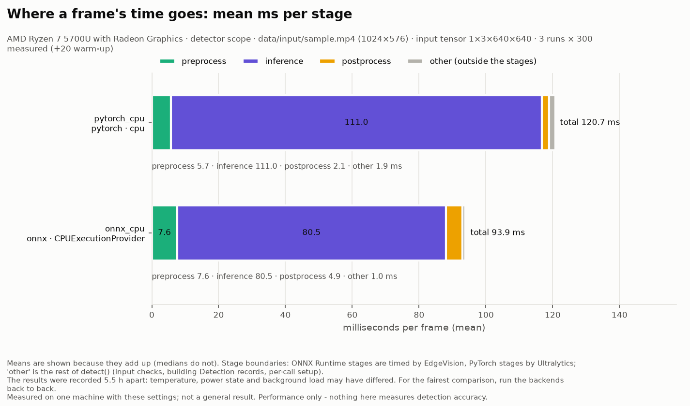

# EdgeVision

**Video object detection and multi-object tracking with a reproducible PyTorch vs ONNX Runtime benchmark.** EdgeVision runs a pretrained YOLOv8n detector through two interchangeable inference backends. It tracks objects with ByteTrack, writes annotated video, and exports and validates ONNX models. It measures latency and throughput with a documented methodology, and keeps three questions strictly apart: how fast, how similar, and how accurate.


[](https://github.com/mukhul/edgevision/actions/workflows/tests.yml)



*Real output of `detect_video.py --backend onnx --tracking` on the 113-frame sample clip, scaled down to 480 px wide. Labels read `class #track-id confidence`. The model's mistakes are left in: the cat is labelled "dog", and a box is labelled "refrigerator". Detection counts are not accuracy.*

> [!NOTE]
> **CPU only.** Every result here was measured on a CPU. The PyTorch CUDA path and ONNX Runtime's CUDA execution provider are implemented and unit-tested with fakes, but they have **never run on an NVIDIA GPU**: none was available. No labelled dataset is included, so **no accuracy has been measured**. The evaluation tools are ready for your own labelled data.

## Key capabilities

- **Two backends, one interface.**
  - PyTorch, through Ultralytics.
  - ONNX Runtime, with EdgeVision's own letterbox, decoding and NMS.

  Both return the same validated `Detection` records. Given the same input tensor, they produce identical detections on the sample clip: 426 of 426, boxes within 0.0003 px.
- **Video pipeline.** Frames are processed one at a time with a frame limit and guaranteed release of the video. Results stream to JSON and are published atomically. Annotated MP4 output is optional and never silently overwrites an existing file.
- **ByteTrack tracking** adds track IDs to the original detections without changing them, and resets between videos.
- **ONNX export** on the CPU through Ultralytics' API, never downloading anything. Each export is checked with the official ONNX checker and a check of the YOLO input/output layout.
- **Benchmarking engine:**
  - initialisation, first inference and warm-up are kept out of the statistics;
  - per-frame latency gets median, mean, p90, p95, min, max and standard deviation;
  - preprocess, inference and postprocess stages are timed separately;
  - throughput is measured per run, and runs that look interrupted (e.g. by the laptop sleeping) are flagged;
  - the JSON result records the hardware, library versions, SHA-256 file hashes and git commit.
- **Analysis:**
  - benchmark plots and a Markdown summary;
  - detection agreement between two runs (explicitly *not* accuracy);
  - precision, recall, F1 and COCO-style AP / mAP@0.5 / mAP@0.5:0.95 against COCO-format ground truth. On synthetic data these match the official `pycocotools` results exactly.
- **Tests.** 800+ automated tests need no GPU, network or model download. Six opt-in tests run the real YOLOv8n model.

## Architecture



Every backend returns the same frozen `Detection` record, so tracking, annotation, comparison and evaluation never depend on which runtime produced the detections. Video decoding, detection and tracking are separate stages, so a benchmark can time the model alone (`detector` scope, frames already in memory) or the whole loop (`pipeline` scope). Module responsibilities are in [`docs/architecture.md`](docs/architecture.md).

## Backends

| Backend | `--backend` | Device | Status |
|---------|-------------|--------|--------|
| PyTorch (Ultralytics) | `pytorch` (default) | CPU | Verified with the real model on Windows and Linux |
| ONNX Runtime | `onnx` | CPU (`CPUExecutionProvider`) | Verified with the real model on Windows and Linux |
| PyTorch | `pytorch --device cuda` | NVIDIA GPU | Implemented; **not run** (no GPU available) |
| ONNX Runtime | `onnx --device cuda` | NVIDIA GPU (`onnxruntime-gpu`) | Implemented; **not run** (no GPU available) |

`--device cuda` never silently falls back to the CPU: it stops with an explanation. The ONNX backend reports the execution providers a session *actually* activated. Supported models: YOLO detection models, FP32, batch 1, square input. Details: [`docs/onnx.md`](docs/onnx.md).

## Installation (Windows)

Verified on Windows 11 with Python 3.11.9 (Command Prompt or PowerShell, from the repository root):

```bat
git clone https://github.com/mukhul/edgevision.git
cd edgevision
py -3.11 -m venv .venv
.venv\Scripts\activate
python -m pip install --upgrade pip
python -m pip install -e ".[dev,vision,detector,tracking,export,onnxruntime,plots]"
```

In PowerShell, activate with `.venv\Scripts\Activate.ps1`. If scripts are blocked, run `Set-ExecutionPolicy -Scope CurrentUser RemoteSigned` once. On Windows, the default PyPI `torch` wheel is the CPU build.

The base package needs only PyYAML. Every command's `--help` works without the extras, and a missing extra produces an install hint, not a traceback.

| Extra | Installs | Needed for |
|-------|----------|------------|
| `dev` | pytest, NumPy | the test suite |
| `vision` | `opencv-python` | reading and writing video and images |
| `detector` | Ultralytics, PyTorch | the PyTorch backend |
| `tracking` | Ultralytics, `lap` | `--tracking` |
| `export` | `onnx`, `onnxslim` | ONNX export and validation (with `detector` and `onnxruntime`) |
| `onnxruntime` | ONNX Runtime (CPU) | the ONNX backend |
| `onnxruntime-gpu` | ONNX Runtime (GPU build) | **instead of** `onnxruntime` on NVIDIA machines, never both (untested) |
| `plots` | matplotlib | benchmark plots |

Install only one OpenCV package. `opencv-python` and `opencv-python-headless` overwrite each other, and `python -m edgevision.device` warns if both are present. On Linux, install the CPU PyTorch wheel first to avoid the large CUDA build: `python -m pip install torch torchvision --index-url https://download.pytorch.org/whl/cpu`.

## Quick start

Put a video at `data\input\sample.mp4` (the config default) or pass another path. Videos and models are never committed.

```bat
:: environment report: OS, CPU, GPU, packages, CUDA support, ONNX Runtime providers
python -m edgevision.device

:: first detection downloads yolov8n.pt (~6 MB) to models\; bus.jpg ships with Ultralytics
python scripts\detect_image.py .venv\Lib\site-packages\ultralytics\assets\bus.jpg

:: check a video: metadata and how many frames actually decode
python scripts\inspect_video.py data\input\sample.mp4

:: export the model to ONNX and validate it structurally
python scripts\export_onnx.py
```

## Video inference and annotated output

```bat
python scripts\detect_video.py data\input\sample.mp4 --json results\sample_detections.json
python scripts\detect_video.py data\input\sample.mp4 --output-video results\sample_annotated.mp4
python scripts\detect_video.py data\input\sample.mp4 --backend onnx --json results\sample_onnx.json
```

- **Summary.** The command prints a processing summary: frames, frames with and without detections, and totals per class. It contains no timing and no accuracy.
- **Options.** `--max-frames N` and `--all-frames` control the frame limit (config default 300). `--conf`, `--iou` and `--imgsz` override the config. `--device` is `auto`, `cpu` or `cuda`.
- **JSON.** `--json` writes every frame's detections in schema `edgevision.video_detections` v1 ([`results/README.md`](results/README.md)), including the backend, model, device, padding and settings.
- **Video.** `--output-video` writes an `mp4v` file at the source size and frame rate. It is published only once complete and kept unless `--overwrite` is given.

More (Python API, record format, writer rules): [`docs/usage.md`](docs/usage.md).

## Tracking

```bat
python scripts\detect_video.py data\input\sample.mp4 --tracking --output-video results\sample_tracked.mp4 --json results\sample_tracks.json
```

ByteTrack (Ultralytics' implementation) runs after either backend, without running the detector again. Track IDs are attached to the original detections, so detection counts and boxes are identical with and without tracking. The tracker resets at the start of each video. `--tracker-config my.yaml` uses custom ByteTrack settings. Track IDs are only consistent within a run. The "distinct IDs" count is not a count of real objects: IDs are lost and reassigned after occlusions.

## ONNX export and validation

```bat
python scripts\export_onnx.py
python scripts\inspect_onnx.py models\yolov8n.onnx --imgsz 640
python scripts\export_onnx.py --imgsz 320 --output models\yolov8n_320.onnx
```

The export runs on the CPU from a local `.pt` file. It checks that its packages are present instead of letting Ultralytics pip-install them, and it never writes next to your weights or replaces an existing file without `--overwrite`. The default export is FP32, batch 1, `images [1,3,640,640]` → `output0 [1,84,8400]`, opset 18, without NMS inside the graph.

Validation is structural: the ONNX checker plus the YOLO layout. Numerical parity with PyTorch is checked separately; see [`docs/onnx.md`](docs/onnx.md#why-pytorch-and-onnx-results-differ-and-how-to-make-them-identical).

## Benchmarking and comparing backends

Run both backends back to back on the same machine, plugged in, on the same power mode, with sleep disabled:

```bat
python scripts\benchmark.py --backend pytorch --device cpu --output results\benchmarks\pytorch_cpu.json
python scripts\benchmark.py --backend onnx --device cpu --output results\benchmarks\onnx_cpu.json
python scripts\compare_benchmarks.py results\benchmarks\pytorch_cpu.json results\benchmarks\onnx_cpu.json
```

- **Defaults** come from `configs/default.yaml`: the config's video, detector scope, 32 frames preloaded, 20 warm-up + 300 measured iterations, 3 runs, each with a freshly loaded model.
- **Same input tensor.** Benchmarks give PyTorch square padding by default, so both backends process the same 1×3×640×640 tensor. Equal detection counts per run confirm they did the same work.
- **Other options.**
  - `--warmup N`, `--iterations N` and `--runs N` set the counts.
  - `--scope pipeline [--tracking]` times decode, detect and track per video frame.
  - An image file works as input.
- **Output.** The JSON result goes to `results\benchmarks\` and is never overwritten without `--overwrite`. `compare_benchmarks.py` lists every setting that differs between files and does not rank them.

Methodology, metric definitions and the fair-comparison checklist: [`docs/benchmarking.md`](docs/benchmarking.md).

## Performance plots

```bat
python scripts\plot_benchmarks.py results\benchmarks\pytorch_cpu.json results\benchmarks\onnx_cpu.json
```

This writes `latency.png`, `throughput.png`, `stages.png`, `latency_runs.png` and `summary.md` to `results\plots\`. It validates each file first and never replaces a missing value with 0 or drops an outlier. Every figure states the CPU, workload and caveats, such as results recorded hours apart or runs that look interrupted.

## Evaluation: agreement vs accuracy

| Question | Command | Measures |
|----------|---------|----------|
| How fast? | `benchmark.py`, `plot_benchmarks.py` | Performance: latency, throughput |
| How similar are two runs? | `compare_detections.py a.json b.json` | **Agreement** between two `detect_video` outputs (same class, IoU ≥ 0.5). Not accuracy |
| How accurate? | `evaluate.py --annotations A.json --images DIR` | **Accuracy** against labelled ground truth: precision, recall, F1, AP, mAP@0.5, mAP@0.5:0.95 |

```bat
python scripts\compare_detections.py results\sample_detections.json results\sample_onnx.json
python scripts\evaluate.py --annotations data\eval\annotations.json --images data\eval\images --backend onnx
```

Agreement only shows that two implementations behave alike: they can agree on a wrong detection. Accuracy needs **labelled ground truth**, which this repository does not include. To evaluate, supply COCO-format JSON (`images`, `annotations` with `[x, y, width, height]` boxes, `categories`) plus the image folder. Categories are matched to the model's classes by name. Matching is COCO-style: greedy by confidence, same class, IoU ≥ threshold, with crowd regions ignored. The format, the metric definitions and their limits are in [`docs/evaluation.md`](docs/evaluation.md).

## Tests

```bat
python -m pytest
```

- **The ordinary suite** needs no GPU, network or model files. OpenCV, PyTorch, Ultralytics and ONNX Runtime are replaced by small fakes where needed, so these tests check EdgeVision's own logic, not the model. A few integration tests use real OpenCV, ONNX or Ultralytics' letterbox and NMS code when installed, and are reported as *skipped* otherwise.
- **The six opt-in real-model tests** run YOLOv8n on the CPU:
  - an image and a short video;
  - ByteTrack keeping one ID;
  - a real ONNX export;
  - ONNX Runtime against Ultralytics on the same file;
  - a tiny benchmark of both backends.

  They need the extras and an existing `models\yolov8n.pt`, and never download.

```bat
:: Command Prompt
set EDGEVISION_RUN_MODEL_TESTS=1
python -m pytest -m model -v
set EDGEVISION_RUN_MODEL_TESTS=
```

In PowerShell, set the variable with `$env:EDGEVISION_RUN_MODEL_TESTS="1"`, then `Remove-Item Env:EDGEVISION_RUN_MODEL_TESTS` afterwards. GitHub Actions runs the ordinary suite on Windows and Linux, plus a base-install job with no extras ([`.github/workflows/tests.yml`](.github/workflows/tests.yml)). Test-by-test coverage: [`tests/README.md`](tests/README.md).

## Measured results

**Machine-specific: one laptop, CPU only.** The numbers come from the result files of Experiments A, B and D in [`docs/experiment_log.md`](docs/experiment_log.md).

| | PyTorch 2.14.1 (CPU) | ONNX Runtime 1.31.0 (CPU) |
|---|---:|---:|
| `detect()` latency, median / p95 | 120.54 / 132.29 ms | 94.61 / 97.24 ms |
| Inference stage, median | 110.68 ms | 80.98 ms |
| Preprocess / postprocess, median | 5.66 / 2.16 ms | 7.74 / 5.05 ms |
| Throughput per run | 8.22, 8.46, 8.18 frames/s | 10.67, 10.63, 10.65 frames/s |
| Initialisation (mean of runs) | 0.167 s | 0.202 s |
| First inference (run 1) | 4386.0 ms | 120.8 ms |
| Detections per run (workload check) | 2117 | 2117 |

**Workload:** YOLOv8n FP32, batch 1, the same 1×3×640×640 input tensor for both backends, confidence 0.25, NMS IoU 0.7. The 32 frames of `sample.mp4` (1024×576) were held in memory (detector scope), with 20 warm-up and 300 measured iterations, 3 runs per backend, at default thread counts.

On this laptop, ONNX Runtime's median `detect()` latency was **21.5% lower** than PyTorch's, and its mean throughput **28.6% higher** (10.65 vs 8.28 frames/s, 1.29×). The gain comes from the inference stage. EdgeVision's NumPy pre- and postprocessing was slower than Ultralytics' (12.8 vs 7.8 ms combined).

<p align="center"> </p>

**Caveats:**
- The two results were recorded 5.5 hours apart, not back to back.
- They were recorded with uncommitted benchmark code (the files record commit `7c787b8` and `uncommitted_changes: true`).
- PyTorch stage times are measured by Ultralytics, ONNX stage times by EdgeVision. Only `detect()` has identical boundaries.

**After those measurements**, the ONNX decoder was changed to filter candidates on the model's native output layout. Its output is bit-identical (unit test plus all 426 detections on the sample clip). On the Linux development machine, with the same workload run back to back, the postprocess median fell from 1.61 to 0.67 ms. The laptop has not been re-measured, so the table above predates the change.

Agreement on the laptop, with default padding: 388 matched pairs out of 407 (PyTorch) and 428 (ONNX) detections. With `--pytorch-letterbox square`, the two backends match exactly ([`docs/onnx.md`](docs/onnx.md#why-pytorch-and-onnx-results-differ-and-how-to-make-them-identical)).

## Tested environments

| Machine | OS / Python | Hardware | Libraries | Ran |
|---------|-------------|----------|-----------|-----|
| Project laptop | Windows 11 (build 26200), Python 3.11.9 | AMD Ryzen 7 5700U (8 cores / 16 threads), **no NVIDIA GPU** | PyTorch 2.14.1+cpu, Ultralytics 8.4.178, ONNX Runtime 1.31.0, onnx 1.23.2, OpenCV 4.14.0.94 | Test suite and real-model tests, detection, tracking, annotated video, export, the recorded benchmarks, plots |
| Development container | Linux, Python 3.11 | Shared cloud CPU, no GPU | The same, with Ultralytics 8.4.178 and 8.4.182 | Every command in this README from a fresh install, the base install without extras, the test suite and real-model tests. Timings not published except where stated |

macOS has not been tested.

## Limitations

- **No GPU validation.** The CUDA paths exist but have only been tested with fakes. "Edge" and real-time performance were design goals; on this CPU, YOLOv8n runs at about 8–11 frames/s, which is below real time for 30 FPS video.
- **No accuracy measured.** No labelled data is included. Detection counts and backend agreement are not accuracy.
- **Benchmark scope.** One recorded CPU comparison, with the backends measured hours apart. Benchmarks are batch 1 and FP32 only, at default thread counts, and do not measure memory, power or temperature.
- **Machine-to-machine differences.** The same video, weights and settings gave slightly different detections on the Windows laptop and on Linux: PyTorch 407 vs 395, ONNX 428 vs 426. Different OpenCV video decoding is a likely, unconfirmed cause. Compare backends on one machine.
- **ONNX backend.** Batch 1, FP32 and square inputs only. Models with NMS inside the graph are supported, but their IoU threshold is fixed at export time.
- **Tracking quality** is not measured (no HOTA, MOTA or IDF1): there are no ground-truth tracks. Only ByteTrack is supported, and it sees only detections above the confidence threshold.
- **Output video** uses `mp4v`, which some browsers cannot play. Odd frame sizes are rejected.
- **Licensing.** Ultralytics YOLO and its pretrained weights are licensed under AGPL-3.0. Ultralytics may send anonymous usage events when online; opt out with `yolo settings sync=False`. The first PyTorch run needs internet access to download `yolov8n.pt`.

## Repository structure

```text
edgevision/
├── configs/default.yaml        # every default, validated on load
├── src/edgevision/
│   ├── config.py, device.py    # config validation; environment / GPU / provider report
│   ├── cli.py, optional.py     # shared options; install hints for missing extras
│   ├── video/                  # reader, annotator, atomic MP4 writer
│   ├── models/                 # Detection record, PyTorch + ONNX backends, factory, export, ONNX validation
│   ├── tracking/               # Tracker protocol, ByteTrack adapter
│   ├── pipeline.py, results.py # per-frame pipeline; streaming JSON results
│   ├── benchmarks/             # runner, statistics, JSON report and comparison
│   └── evaluation/             # metrics, COCO loader, agreement, benchmark plots
├── scripts/                    # 10 commands; see scripts/README.md
├── tests/                      # ordinary suite + opt-in real-model tests; see tests/README.md
├── docs/                       # architecture, usage, onnx, benchmarking, evaluation, experiment log, assets/
├── .github/workflows/tests.yml # CI: tests on Windows and Linux, plus a base install
├── data/  models/  results/    # local inputs, weights and outputs (git-ignored apart from READMEs)
└── pyproject.toml              # package, extras, pytest settings
```

## What this project demonstrates

- **Inference engineering:** an ONNX Runtime backend that reproduces Ultralytics' letterbox, decoding and NMS exactly, verified to floating-point precision against PyTorch on the same input tensor.
- **Measurement discipline:** separated timing phases and scopes, repeated fresh-model runs, percentiles and full traceability. A real CPU comparison is reported with its caveats.
- **Separate questions:** performance, agreement and accuracy each have their own tools and wording.
- **Robust tooling:** atomic outputs, no silent overwrites or downloads, clear errors for missing dependencies and hardware, and over 800 tests that run without a GPU or network.
