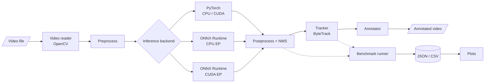

# EdgeVision — GPU-Accelerated Real-Time Perception Engine


> [!IMPORTANT]
> **This repository is in early development.**
> Implemented so far: an installable package, validated configuration loading, an environment report, a frame-by-frame video reader, and single-image object detection with a pretrained YOLOv8n model on PyTorch. Detection is not yet connected to video, and tracking, ONNX export, GPU execution, and benchmarking are not implemented. **No benchmark results have been recorded.** Everything described below as *planned* is the design target, not existing functionality.

## Overview

EdgeVision is an ongoing computer vision and performance-engineering project focused on building a video perception pipeline and evaluating inference performance across PyTorch and ONNX Runtime. The project aims to investigate the trade-offs between inference latency, throughput, and detection quality under reproducible benchmarking conditions.

### Motivation

Choosing an inference runtime is an engineering decision that should rest on measurements, yet runtime comparisons are easy to get wrong: warm-up iterations leak into averages, asynchronous CUDA execution is timed without synchronization, end-to-end pipeline speed is reported as pure model speed, and single best-case runs stand in for typical behaviour. EdgeVision is being built to answer a narrow question carefully — *for the same model, weights, and frames, how do PyTorch and ONNX Runtime compare on latency, throughput, and output agreement, on CPU and (where available) GPU?* — with a methodology that makes every result traceable to its configuration and hardware.

## Project status

| Capability | Planned | Implemented | Benchmarked |
|------------|:-------:|:-----------:|:-----------:|
| Installable package (`pip install -e ".[dev]"`) | ✅ | ✅ | n/a |
| Configuration loading and validation | ✅ | ✅ | n/a |
| Hardware / software environment report | ✅ | ✅ | n/a |
| Video input (OpenCV, prerecorded files) | ✅ | ✅ | n/a |
| Object detection — PyTorch backend (single image / frame) | ✅ | ✅ ¹ | — |
| Detection on video frames (pipeline) | ✅ | — | — |
| ONNX export and numerical validation | ✅ | — | — |
| Object detection — ONNX Runtime CPU | ✅ | — | — |
| Object detection — ONNX Runtime CUDA (when available) | ✅ | — | — |
| Multi-object tracking (ByteTrack) | ✅ | — | — |
| Annotated output video | ✅ | — | — |
| Latency / throughput benchmark runner | ✅ | — | — |
| Detection-quality evaluation (ground truth) | ✅ | — | — |
| Tests for the pipeline, backends, and benchmarks | ✅ | — | n/a |

- **Planned** — described in the project specification; not yet built.
- **Implemented** — exists in this repository and is covered by passing tests.
- **Benchmarked** — measured, with results and configuration recorded in [`docs/experiment_log.md`](docs/experiment_log.md).

¹ Covered by mocked unit tests **and** by a real-model test (`yolov8n.pt` on CPU, Linux, PyTorch 2.14.1 CPU build, Ultralytics 8.4.178). The real test is opt-in; see [Tests](#tests). No speed or accuracy figures have been measured.

**What exists today:**

- An installable `edgevision` package (src layout) whose only required dependency is PyYAML.
- `edgevision.config`: loads `configs/default.yaml` (or any given file) into typed, immutable settings. Missing fields, wrong types, out-of-range values, unknown fields and duplicate keys are rejected, and every problem is listed with its location.
- `edgevision.device`: reports Python, OS, CPU, NVIDIA GPU hardware (via `nvidia-smi`), optional packages, PyTorch CUDA support and ONNX Runtime execution providers. It works when PyTorch and ONNX Runtime are not installed, and keeps "a GPU is present" separate from "a framework can use it".
- `edgevision.video.VideoReader`: reads a prerecorded video one frame at a time (BGR, zero-based indices), with an optional `max_frames` limit, defensive metadata handling (width, height, FPS, reported frame count, codec) and guaranteed release of the OpenCV capture. OpenCV is an optional extra (`vision`).
- `scripts/inspect_video.py`: reports a video's metadata, how many frames could actually be decoded, and why reading stopped.
- `edgevision.models`: a backend-independent `Detection` record (frame index, `xyxy` box in original-image pixels, confidence, class ID, class name; validated and immutable), shared `DetectionSettings` (input size, thresholds, class filter), a `Detector` protocol, and `PytorchYoloDetector`, which runs a pretrained Ultralytics YOLO model on one BGR frame with `auto` / `cpu` / `cuda` device selection. An explicit `cuda` request fails clearly instead of silently using the CPU.
- `scripts/detect_image.py`: runs the detector on one image, prints the detections, and can save them as JSON.
- pytest tests for all of the above. They need no GPU, network, or ML packages; OpenCV, PyTorch and Ultralytics are replaced by fakes in unit tests. A few integration tests use real OpenCV when it is installed, and one opt-in test runs the real YOLOv8n model.
- A `.gitignore` that keeps weights, videos and results out of Git, and design documents for the architecture and benchmarking methodology.

## Intended scope

- Lightweight pretrained object detection (initially YOLOv8n) on recorded video
- Multi-object tracking with persistent track IDs
- PyTorch and ONNX Runtime inference backends driven through one interface
- CPU as a first-class mode, with optional NVIDIA GPU execution when hardware is actually available
- Repeatable latency and throughput benchmarking with machine-readable results (JSON/CSV) and plots
- Detection-quality evaluation when suitable ground-truth annotations are available

**Out of scope for now:** live camera input, production deployment, and real-time guarantees on any particular hardware.

## Planned architecture



Detection and tracking are deliberately separate stages so that detection-only benchmarks are possible. Every backend will emit the same detection record — frame index, `xyxy` box in source-frame pixels, confidence, class ID, class name — so tracking and evaluation do not depend on which runtime produced the detections. Component responsibilities are described in [`docs/architecture.md`](docs/architecture.md).

## Intended technology stack

| Area | Tools |
|------|-------|
| Language | Python 3.11 |
| Detection model | Ultralytics YOLO (YOLOv8n to start) |
| Deep learning framework | PyTorch |
| Model interchange | ONNX |
| Inference runtime | ONNX Runtime (CPU EP; CUDA EP when available) |
| Tracking | ByteTrack (existing implementation) |
| Video I/O | OpenCV |
| Data and analysis | NumPy, Pandas |
| Visualization | Matplotlib |
| Configuration | PyYAML |
| Testing | pytest |
| Compute | Local CPU; Google Colab or Kaggle GPUs when available |

TensorRT is an optional stretch goal, not a dependency.

## Repository structure

Current contents:

```text
edgevision/
├── README.md
├── pyproject.toml           # package metadata, dependencies, pytest settings
├── .gitignore
├── configs/
│   └── default.yaml         # default experiment settings (single source of defaults)
├── src/
│   └── edgevision/
│       ├── __init__.py      # package marker and version
│       ├── config.py        # YAML loading and validation
│       ├── device.py        # environment / hardware report
│       ├── optional.py      # helpful errors for missing optional packages
│       ├── models/
│       │   ├── __init__.py
│       │   ├── base.py      # Detection, DetectionSettings, Detector protocol
│       │   └── pytorch_backend.py  # PytorchYoloDetector (Ultralytics YOLO)
│       └── video/
│           ├── __init__.py
│           └── reader.py    # frame-by-frame video reading (OpenCV)
├── scripts/
│   ├── README.md            # CLI entry points (implemented and planned)
│   ├── detect_image.py      # run the detector on one image
│   └── inspect_video.py     # report video metadata and decodable frames
├── tests/
│   ├── README.md            # how to run tests; planned coverage
│   ├── test_config.py
│   ├── test_device.py
│   ├── conftest.py          # fake PyTorch/Ultralytics used by detector tests
│   ├── test_detect_image.py
│   ├── test_detection.py
│   ├── test_inspect_video.py
│   ├── test_package.py
│   ├── test_pytorch_backend.py
│   └── test_video_reader.py
├── docs/
│   ├── architecture.md      # planned components and data flow
│   ├── benchmarking.md      # planned timing methodology
│   └── experiment_log.md    # empty until experiments are run
├── data/
│   ├── README.md
│   └── input/               # local videos (git-ignored)
├── models/
│   └── README.md            # local weights (yolov8n.pt) and ONNX exports (git-ignored)
└── results/
    └── README.md            # benchmark outputs (git-ignored)
```

Planned modules under `src/edgevision/` (added only as they are implemented): `models/` (ONNX backend, export), `video/writer`, `tracking/`, `benchmarks/` (timing, runner, metrics, report), `evaluation/`, and `pipeline`.

## Planned benchmark methodology

- **Two scopes, reported separately:** model-only inference, and end-to-end frame processing with the included stages (decode, preprocess, inference, postprocess, tracking, rendering) stated explicitly.
- **Phases kept apart:** model load time, warm-up time, and steady-state latency are recorded separately; load and warm-up never enter steady-state statistics.
- **Correct GPU timing:** CUDA work is synchronized before the clock is read; ONNX Runtime results state which execution provider was actually active.
- **Statistics:** mean, median, p90, p95 per run; throughput as frames ÷ measured wall-clock interval, reported separately from `1 / mean latency`.
- **Fairness:** identical weights, input resolution, thresholds, class filter, video, frame sequence, warm-up count, and frame count across backends; batch size 1 by default.
- **Repetition:** at least three runs per configuration where compute permits, with variation reported — never just the best run.
- **Quality:** precision / recall / F1 (and mAP only where the protocol supports it) against ground-truth annotations; without ground truth, only backend-agreement diagnostics, which are explicitly **not** accuracy.
- **Traceability:** every result records its config, git commit, hardware, OS, library versions, and execution provider.

Details: [`docs/benchmarking.md`](docs/benchmarking.md).

## Setup and usage

Requires Python 3.11 or newer. Run all commands from the repository root.

### Available now

Optional extras keep the base install light. Install only what you need:

| Extra | Installs | Needed for |
|-------|----------|------------|
| `dev` | pytest, NumPy | running the tests |
| `vision` | `opencv-python` | reading video and images |
| `detector` | Ultralytics, PyTorch (and torchvision via Ultralytics) | YOLO object detection |

Windows (PowerShell):

```powershell
git clone https://github.com/mukhul/edgevision.git
cd edgevision
py -3.11 -m venv .venv
.venv\Scripts\Activate.ps1
python -m pip install --upgrade pip
python -m pip install -e ".[dev,vision,detector]"
```

If PowerShell refuses to run `Activate.ps1`, run `Set-ExecutionPolicy -Scope CurrentUser RemoteSigned` once, or use Command Prompt with `.venv\Scripts\activate.bat`. On Windows the default PyPI `torch` wheel is the CPU-only build, which is what a laptop without an NVIDIA GPU needs.

Linux / macOS:

```bash
git clone https://github.com/mukhul/edgevision.git
cd edgevision
python3.11 -m venv .venv
source .venv/bin/activate
python -m pip install --upgrade pip
# Linux without an NVIDIA GPU: install the much smaller CPU-only PyTorch build first
python -m pip install torch torchvision --index-url https://download.pytorch.org/whl/cpu
python -m pip install -e ".[dev,vision,detector]"
```

On Linux the default PyPI `torch` wheel is a large CUDA build; the extra line above avoids it. macOS wheels from PyPI are CPU/MPS builds. No CUDA-specific PyTorch build is pinned by this project.

> [!WARNING]
> **One OpenCV package only.** `opencv-python` and `opencv-python-headless` both install the same `cv2` module and silently overwrite each other. EdgeVision uses `opencv-python` because Ultralytics requires it. If an environment created before the detector was added still has `opencv-python-headless`, uninstall **both** and reinstall:
>
> ```bash
> python -m pip uninstall -y opencv-python-headless opencv-python
> python -m pip install -e ".[dev,vision,detector]"
> ```
>
> `python -m edgevision.device` warns if more than one OpenCV package is installed.

Then:

```bash
python -m edgevision.device          # hardware, packages, CUDA support, ONNX Runtime providers
python -m edgevision.device --json   # the same report as JSON
python -m edgevision.config          # validate configs/default.yaml (or pass another path)
python -m pytest                     # run the test suite

# Report a video's metadata and how many frames can be decoded
python scripts/inspect_video.py data/input/sample.mp4
python scripts/inspect_video.py data/input/sample.mp4 --max-frames 100

# Detect objects in one image (first run downloads yolov8n.pt, ~6 MB, to models/)
python scripts/detect_image.py path/to/photo.jpg
python scripts/detect_image.py path/to/photo.jpg --device cpu --conf 0.4 --json results/photo.json
```

`detect_image.py` takes its model, input size, thresholds and class filter from `configs/default.yaml`; `--model`, `--imgsz`, `--conf` and `--iou` override them. `--device` is `auto` (CUDA only if PyTorch can use it, otherwise CPU), `cpu`, or `cuda` (fails with an explanation if CUDA is unavailable). `--json` refuses to replace an existing file unless `--overwrite` is given. Exit status is 0 on success, 1 if the image, model or inference fails, and 2 for invalid arguments.

Reading video and detecting objects from Python:

```python
from edgevision.models import DetectionSettings, PytorchYoloDetector
from edgevision.video import VideoReader

with VideoReader("data/input/sample.mp4", max_frames=100) as reader:
    print(reader.metadata)            # width, height, fps, frame_count, fourcc (None if unknown)
    for frame_index, frame in reader:  # frame: BGR uint8 array, shape (height, width, 3)
        ...
print(reader.frames_read, reader.stop_reason)  # e.g. 100 StopReason.MAX_FRAMES

settings = DetectionSettings(input_size=640, conf_threshold=0.25, iou_threshold=0.7)
with PytorchYoloDetector("models/yolov8n.pt", device="auto", settings=settings) as detector:
    for d in detector.detect(frame, frame_index=0):  # any BGR uint8 frame
        print(d.class_name, round(d.confidence, 2), d.bbox_xyxy)  # box in original-image pixels
```

#### The detection interface

Every backend returns the same `Detection` records, so later stages (tracking, drawing, evaluation, PyTorch-vs-ONNX comparison) never depend on library-specific output:

| Field | Meaning |
|-------|---------|
| `frame_index` | Zero-based index of the frame the detection came from |
| `bbox_xyxy` | `(x1, y1, x2, y2)`: top-left and bottom-right corners in pixels of the **original** frame (not the resized model input) |
| `confidence` | Score in `[0, 1]` after non-maximum suppression |
| `class_id`, `class_name` | Model class index and label, e.g. `15`, `"cat"` (COCO classes for the pretrained model) |

Records are validated when created (finite numbers, confidence in range, non-negative integer IDs, `x1 <= x2` and `y1 <= y2`, non-empty name) and cannot be modified afterwards. Input frames must be `uint8` arrays of shape `(height, width, 3)` in OpenCV's **BGR** order.

`PytorchYoloDetector` validates inputs and settings, selects the device, calls Ultralytics, and converts its output. Ultralytics does the computer vision itself: letterbox resizing, BGR to RGB conversion, the forward pass, non-maximum suppression, and scaling boxes back to the original frame.

#### Tests

`python -m pytest` runs unit tests in which OpenCV, PyTorch and Ultralytics are replaced by fakes where needed; they check EdgeVision's own logic (validation, device choice, argument passing, output conversion, error handling) and never download anything. They do **not** prove that the real model works. One additional test runs the genuine YOLOv8n model on a photo bundled with Ultralytics. It is opt-in, and needs the `detector` extra and an already-downloaded `models/yolov8n.pt` (run `detect_image.py` once):

```bash
# Linux / macOS
EDGEVISION_RUN_MODEL_TESTS=1 python -m pytest -m model -v
```

```bat
:: Windows Command Prompt
set EDGEVISION_RUN_MODEL_TESTS=1
python -m pytest -m model -v
```

#### Ultralytics notes

- Ultralytics creates a settings file on first import (for example `%APPDATA%\Ultralytics\settings.json` on Windows, `~/.config/Ultralytics/settings.json` on Linux).
- With its default setting `sync: true`, Ultralytics sends anonymous usage events for runs such as prediction when online. To opt out: `yolo settings sync=False`.
- Ultralytics and its pretrained weights are licensed under AGPL-3.0.

### Planned interface

> [!NOTE]
> **Forthcoming.** These commands show the intended interface and do not work yet.

```bash
# Export the PyTorch model to ONNX and validate it against PyTorch outputs
python scripts/export_onnx.py

# Process a video with tracking and write an annotated output
python scripts/run_video.py --input data/input/sample.mp4 --backend pytorch --output results/annotated_pytorch.mp4

# Benchmark backends on identical frames
python scripts/benchmark.py --input data/input/sample.mp4 --backends pytorch onnx_cpu --warmup 20 --frames 300 --runs 3 --output results/benchmark

# Plot saved results
python scripts/plot_results.py --input results/benchmark --output results/plots
```

CUDA-enabled PyTorch wheels and GPU setup instructions will be documented separately once GPU execution has been verified.

## Roadmap

- [x] Initial repository scaffold and design documents
- [x] Installable package with a pytest setup
- [x] Configuration loading and validation
- [x] Hardware / software environment report
- [ ] Device and execution-provider selection for inference backends
- [x] Video reader with frame limit and robust error handling
- [x] Detection interface and PyTorch detection backend (single frame)
- [ ] Run detection on video frames
- [ ] Annotated video output
- [ ] Multi-object tracking with ByteTrack
- [ ] ONNX export with output-shape, finite-value, and numerical-agreement checks
- [ ] ONNX Runtime CPU backend
- [ ] Benchmark runner with JSON / CSV export
- [ ] Plot generation from saved results
- [ ] CPU-only unit and integration tests
- [ ] ONNX Runtime CUDA backend (verified execution provider)
- [ ] Detection-quality evaluation on an annotated dataset
- [ ] First recorded benchmarks (Experiments A–E in [`docs/experiment_log.md`](docs/experiment_log.md))

## Benchmark results

None yet. Results will be published in [`docs/experiment_log.md`](docs/experiment_log.md) only after they have been measured, together with the hardware, software versions, and configuration that produced them.

## Known limitations

- Detection runs on single images or frames only; it is not yet connected to the video reader, and there is no tracking, annotated output, ONNX backend, or benchmarking.
- Real model inference has been verified on Linux (CPU). GPU (CUDA) inference has not been tested: no NVIDIA GPU was available.
- The first use of an official model name (e.g. `yolov8n.pt`) needs an internet connection to download the weights.
- Video metadata is what the file *reports*; the frame count in particular can be missing or wrong. OpenCV signals the end of a video and an undecodable frame the same way, so a corrupt file may simply end early (the inspection command flags this when the reported count is larger).
- `configs/default.yaml` is validated but not yet used by any pipeline stage; fields may still change as those stages are built.
- The environment report shows what the installed frameworks *offer*. Whether inference really runs on a GPU will only be verified once the inference backends exist.
- Free cloud GPUs vary in model and availability, so any GPU results will apply only to the recorded hardware.
- ONNX Runtime may not be faster than PyTorch for a given model and device; the project will report whatever is observed.

## Future work

- Optional TensorRT experiments (via the ONNX Runtime TensorRT execution provider or a standalone engine)
- FP16 inference, validated against the FP32 baseline
- Batch-size experiments alongside the default batch size of 1
- ONNX Runtime I/O binding to measure the cost of host ↔ device copies
- Tracking metrics (e.g. HOTA, IDF1) once annotated multi-object tracking data is included

## License

A license has not been chosen yet. Note that Ultralytics YOLO and its pretrained weights are distributed under AGPL-3.0, which should be considered when choosing a license for this project. Model weights, datasets, and videos are not distributed in this repository.
