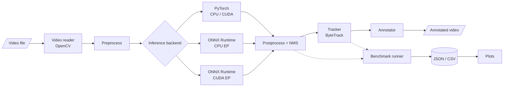
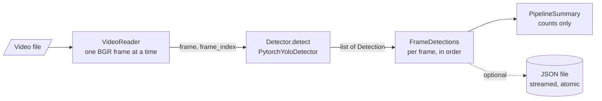
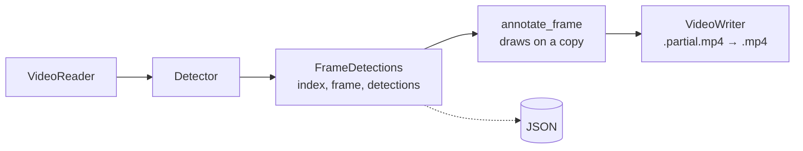
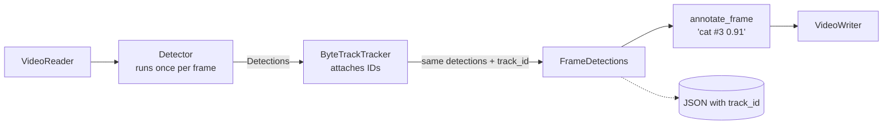
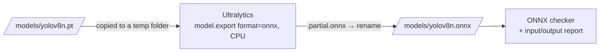
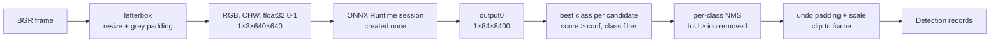

# EdgeVision — GPU-Accelerated Real-Time Perception Engine


> [!IMPORTANT]
> **This repository is in early development.**
> Implemented so far: an installable package, validated configuration loading, an environment report, a frame-by-frame video reader, object detection with a pretrained YOLOv8n model on PyTorch, a pipeline that runs detection over every frame of a prerecorded video with a summary and optional JSON output, an annotated copy of the video with boxes, class names and confidences, optional multi-object tracking with ByteTrack (track IDs in the video and JSON), export of the model to ONNX with structural validation, an ONNX Runtime backend (`--backend onnx`) that runs the exported model on the CPU through the same pipeline, and a benchmarking tool that measures initialisation time, per-frame latency and throughput of either backend and saves the measurements as JSON. GPU execution has not been tested, and there is no systematic PyTorch-vs-ONNX accuracy comparison yet. **No benchmark results have been recorded in this repository.** Everything described below as *planned* is the design target, not existing functionality.

## Overview

EdgeVision is an ongoing computer vision and performance-engineering project focused on building a video perception pipeline and evaluating inference performance across PyTorch and ONNX Runtime. The project aims to investigate the trade-offs between inference latency, throughput, and detection quality under reproducible benchmarking conditions.

### Motivation

Choosing an inference runtime is an engineering decision that should rest on measurements, yet runtime comparisons are easy to get wrong: warm-up iterations leak into averages, asynchronous CUDA execution is timed without synchronization, end-to-end pipeline speed is reported as pure model speed, and single best-case runs stand in for typical behaviour. EdgeVision is being built to answer a narrow question carefully — *for the same model, weights, and frames, how do PyTorch and ONNX Runtime compare on latency, throughput, and output agreement, on CPU and (where available) GPU?* — with a methodology that makes every result traceable to its configuration and hardware.

## Project status

| Capability | Planned | Implemented | Benchmarked |
|------------|:-------:|:-----------:|:-----------:|
| Installable package (`pip install -e ".[dev]"`) | ✅ | ✅ | n/a |
| Configuration loading and validation | ✅ | ✅ | n/a |
| Hardware / software environment report | ✅ | ✅ | n/a |
| Video input (OpenCV, prerecorded files) | ✅ | ✅ | n/a |
| Object detection — PyTorch backend (single image / frame) | ✅ | ✅ ¹ | — |
| Detection on video frames (pipeline, summary, JSON export) | ✅ | ✅ ² | — |
| ONNX export and structural validation | ✅ | ✅ ⁵ | n/a |
| ONNX numerical validation (PyTorch vs ONNX outputs) | ✅ | — | — |
| Object detection — ONNX Runtime CPU | ✅ | ✅ ⁶ | — |
| Object detection — ONNX Runtime CUDA (when available) | ✅ | code path only, untested ⁶ | — |
| Multi-object tracking (ByteTrack, optional) | ✅ | ✅ ⁴ | n/a |
| Annotated output video (boxes, class names, confidences) | ✅ | ✅ ³ | n/a |
| Latency / throughput benchmark runner | ✅ | ✅ ⁷ | — |
| Detection-quality evaluation (ground truth) | ✅ | — | — |
| Tests for the pipeline, backends, and benchmarks | ✅ | ✅ | n/a |

- **Planned** — described in the project specification; not yet built.
- **Implemented** — exists in this repository and is covered by passing tests.
- **Benchmarked** — measured, with results and configuration recorded in [`docs/experiment_log.md`](docs/experiment_log.md).

¹ Covered by mocked unit tests **and** by a real-model test (`yolov8n.pt` on CPU, Linux, PyTorch 2.14.1 CPU build, Ultralytics 8.4.178). The real test is opt-in; see [Tests](#tests). No speed or accuracy figures have been measured.

² Covered by mocked unit tests, by integration tests with real OpenCV, and by an opt-in real-model test on a short video. The command was also run end to end with the real YOLOv8n model on a 113-frame, 1024×576 H.264 clip on Linux (CPU). Detection counts describe what the model output, not whether it was correct: the processing summary is neither an accuracy nor a speed measurement.

³ Covered by annotator tests on real pixels, mocked writer tests, real write-and-reopen integration tests, and command tests. The command was run end to end with the real YOLOv8n model on the same 113-frame clip (Linux, CPU): the annotated MP4 reopened at the source's 1024×576 and 30 FPS with all 113 frames, and sample frames were inspected visually.

⁴ Covered by tests of the real Ultralytics ByteTrack on hand-made moving boxes (stable IDs, briefly missed objects, reset, low-score continuation), mocked pipeline and command tests, and an opt-in real YOLOv8n + ByteTrack test. It was also run end to end on the 113-frame clip (Linux, CPU) with an annotated video and JSON, and sample frames were inspected visually. No tracking accuracy has been measured: there is no ground truth.

⁵ Covered by mocked unit tests (Ultralytics and `onnx` replaced by fakes), tests on small real ONNX files built with the `onnx` package, and an opt-in real-model test that exports `yolov8n.pt` at 320×320 and validates it. The command was also run for real on Linux (CPU; PyTorch 2.14.1, Ultralytics 8.4.178, onnx 1.23.2): `models/yolov8n.onnx` (12,851,106 bytes, opset 18) passed the official ONNX checker with input `images` FLOAT `[1, 3, 640, 640]` and output `output0` FLOAT `[1, 84, 8400]`. This shows the file is well-formed, **not** that it gives the same detections as PyTorch; that comparison is a later step.

⁶ Covered by unit tests with a fake ONNX Runtime session and synthetic model outputs, by tests that compare EdgeVision's letterbox and NMS code with Ultralytics' own implementations on random inputs, by command tests, and by an opt-in real CPU test. Run for real on Linux (CPU, ONNX Runtime 1.31.0): on three test images EdgeVision's ONNX backend gave the same detections as Ultralytics running the same `.onnx` file (largest box difference below 0.0001 px). It also gave the same detections as the PyTorch model **when both used the same square 640×640 input** (largest box difference 0.0001 px, score difference below 10⁻⁶). With default settings the two backends do differ, because the PyTorch backend pads frames to a smaller rectangle; see [Why PyTorch and ONNX results differ slightly](#why-pytorch-and-onnx-results-differ-slightly). The CUDA provider path is implemented and unit-tested with fakes, but no NVIDIA GPU was available to run it.

⁷ Covered by tests with a fake clock and fake detectors (exact checks of which intervals count towards which metric), tests of the statistics against NumPy, schema and command tests, and an opt-in real CPU smoke benchmark of both backends. It was also run for real on Linux (CPU) with both backends and the default settings, to check that it works end to end. Those timings come from a shared cloud machine and are deliberately not published; no results are recorded in [`docs/experiment_log.md`](docs/experiment_log.md) yet, hence the empty *Benchmarked* column.

**What exists today:**

- An installable `edgevision` package (src layout) whose only required dependency is PyYAML.
- `edgevision.config`: loads `configs/default.yaml` (or any given file) into typed, immutable settings. Missing fields, wrong types, out-of-range values, unknown fields and duplicate keys are rejected, and every problem is listed with its location.
- `edgevision.device`: reports Python, OS, CPU, NVIDIA GPU hardware (via `nvidia-smi`), optional packages, PyTorch CUDA support and ONNX Runtime execution providers. It works when PyTorch and ONNX Runtime are not installed, and keeps "a GPU is present" separate from "a framework can use it".
- `edgevision.video.VideoReader`: reads a prerecorded video one frame at a time (BGR, zero-based indices), with an optional `max_frames` limit, defensive metadata handling (width, height, FPS, reported frame count, codec) and guaranteed release of the OpenCV capture. OpenCV is an optional extra (`vision`).
- `scripts/inspect_video.py`: reports a video's metadata, how many frames could actually be decoded, and why reading stopped.
- `edgevision.models`: a backend-independent `Detection` record (frame index, `xyxy` box in original-image pixels, confidence, class ID, class name; validated and immutable), shared `DetectionSettings` (input size, thresholds, class filter), a `Detector` protocol, and `PytorchYoloDetector`, which runs a pretrained Ultralytics YOLO model on one BGR frame with `auto` / `cpu` / `cuda` device selection. An explicit `cuda` request fails clearly instead of silently using the CPU.
- `scripts/detect_image.py`: runs the detector on one image, prints the detections, and can save them as JSON.
- `edgevision.pipeline`: `VideoDetectionPipeline` feeds every frame from `VideoReader` to an already-created detector, one frame at a time, yields per-frame results (`FrameDetections`), and keeps only counters for its `PipelineSummary`. `edgevision.results` streams those results to a JSON file that only appears once it is complete.
- `edgevision.video.annotator`: draws each detection (box, class name, confidence) on a **copy** of a frame, in a fixed colour per class.
- `edgevision.video.writer`: writes frames to an `.mp4` file with validated size and frame rate, and publishes it only when complete.
- `edgevision.tracking`: `TrackedDetection` (a `Detection` plus `track_id`), a `Tracker` protocol, and `ByteTrackTracker`, which feeds each frame's detections to Ultralytics' ByteTrack and attaches the resulting IDs to the original detections.
- `scripts/detect_video.py`: runs detection over a video, prints a processing summary, and can save per-frame detections as JSON and/or an annotated copy of the video. `--tracking` adds ByteTrack track IDs to both.
- `edgevision.models.export`: `export_onnx()` exports a YOLO `.pt` model to ONNX on the CPU through Ultralytics' export API, without downloading anything, writing next to the weights, or replacing an existing file unless asked.
- `edgevision.models.onnx_validation`: `validate_onnx()` runs the official ONNX checker and describes the model's inputs, outputs, opset and metadata; `yolo_layout_problems()` checks that they look like a YOLO detection model.
- `scripts/export_onnx.py` (export, then validate) and `scripts/inspect_onnx.py` (validate and describe an existing `.onnx` file).
- `edgevision.models.onnx_backend`: `OnnxYoloDetector` runs an exported `.onnx` model with ONNX Runtime behind the same `Detector` interface, with explicit execution-provider selection and its own preprocessing, decoding and NMS. It does not need PyTorch or Ultralytics.
- `--backend pytorch|onnx` in `detect_image.py` and `detect_video.py` (PyTorch stays the default). Tracking, annotated video and JSON output work with either backend.
- `edgevision.benchmarks` and `scripts/benchmark.py`: timed runs of either backend with warm-up, repeated runs, separate initialisation / first-inference / per-frame latency / throughput measurements, latency statistics, and a JSON result with the full environment. `scripts/compare_benchmarks.py` shows results side by side and lists the settings that differ.
- pytest tests for all of the above. They need no GPU, network, or ML packages; OpenCV, PyTorch, Ultralytics and ONNX are replaced by fakes in unit tests. A few integration tests use real OpenCV or ONNX when installed, and opt-in tests run the real YOLOv8n model.
- A `.gitignore` that keeps weights, videos and results out of Git, and design documents for the architecture and benchmarking methodology.

## Intended scope

- Lightweight pretrained object detection (initially YOLOv8n) on recorded video
- Multi-object tracking with persistent track IDs
- PyTorch and ONNX Runtime inference backends driven through one interface
- CPU as a first-class mode, with optional NVIDIA GPU execution when hardware is actually available
- Repeatable latency and throughput benchmarking with machine-readable results (JSON/CSV) and plots
- Detection-quality evaluation when suitable ground-truth annotations are available

**Out of scope for now:** live camera input, production deployment, and real-time guarantees on any particular hardware.

## Planned architecture



Detection and tracking are deliberately separate stages so that detection-only benchmarks are possible. Every backend will emit the same detection record — frame index, `xyxy` box in source-frame pixels, confidence, class ID, class name — so tracking and evaluation do not depend on which runtime produced the detections. Component responsibilities are described in [`docs/architecture.md`](docs/architecture.md).

## Intended technology stack

| Area | Tools |
|------|-------|
| Language | Python 3.11 |
| Detection model | Ultralytics YOLO (YOLOv8n to start) |
| Deep learning framework | PyTorch |
| Model interchange | ONNX |
| Inference runtime | ONNX Runtime (CPU EP; CUDA EP when available) |
| Tracking | ByteTrack (existing implementation) |
| Video I/O | OpenCV |
| Data and analysis | NumPy, Pandas |
| Visualization | Matplotlib |
| Configuration | PyYAML |
| Testing | pytest |
| Compute | Local CPU; Google Colab or Kaggle GPUs when available |

TensorRT is an optional stretch goal, not a dependency.

## Repository structure

Current contents:

```text
edgevision/
├── README.md
├── pyproject.toml           # package metadata, dependencies, pytest settings
├── .gitignore
├── configs/
│   └── default.yaml         # default experiment settings (single source of defaults)
├── src/
│   └── edgevision/
│       ├── __init__.py      # package marker and version
│       ├── benchmarks/
│       │   ├── __init__.py
│       │   ├── runner.py    # timed warm-up/measured iterations, detector and pipeline scopes
│       │   ├── stats.py     # mean, percentiles, stdev, throughput
│       │   └── report.py    # JSON schema, environment metadata, summary, comparison
│       ├── config.py        # YAML loading and validation
│       ├── device.py        # environment / hardware report
│       ├── optional.py      # helpful errors for missing optional packages
│       ├── tracking/
│       │   ├── __init__.py
│       │   ├── base.py      # TrackedDetection, Tracker protocol
│       │   └── bytetrack.py # ByteTrackTracker (Ultralytics ByteTrack)
│       ├── cli.py           # option parsing shared by the detection commands
│       ├── pipeline.py      # VideoReader -> Detector, per-frame results, summary
│       ├── results.py       # streaming, atomic JSON output for video detections
│       ├── models/
│       │   ├── __init__.py
│       │   ├── base.py      # Detection, DetectionSettings, Detector protocol
│       │   ├── export.py    # export_onnx(): .pt -> .onnx via Ultralytics, CPU
│       │   ├── factory.py   # create_detector(backend, ...), --backend checks
│       │   ├── onnx_backend.py  # OnnxYoloDetector (ONNX Runtime) + pre/postprocessing
│       │   ├── onnx_validation.py  # validate_onnx(): ONNX checker + input/output report
│       │   └── pytorch_backend.py  # PytorchYoloDetector (Ultralytics YOLO)
│       └── video/
│           ├── __init__.py
│           ├── annotator.py # draw boxes and labels on a copy of a frame
│           ├── reader.py    # frame-by-frame video reading (OpenCV)
│           └── writer.py    # validated, all-or-nothing video file writing
├── scripts/
│   ├── README.md            # CLI entry points (implemented and planned)
│   ├── benchmark.py         # time a backend and save the measurements as JSON
│   ├── compare_benchmarks.py  # show result files side by side
│   ├── detect_image.py      # run the detector on one image
│   ├── detect_video.py      # run the detector on every frame of a video
│   ├── export_onnx.py       # export the model to ONNX and validate it
│   ├── inspect_onnx.py      # validate and describe an ONNX file
│   └── inspect_video.py     # report video metadata and decodable frames
├── tests/
│   ├── README.md            # how to run tests; planned coverage
│   ├── test_config.py
│   ├── test_device.py
│   ├── conftest.py          # fake PyTorch/Ultralytics used by detector tests
│   ├── test_detect_image.py
│   ├── test_annotator.py
│   ├── test_backend_selection.py
│   ├── test_benchmark_report.py
│   ├── test_benchmark_runner.py
│   ├── test_benchmark_scripts.py
│   ├── test_benchmark_stats.py
│   ├── test_detect_video.py
│   ├── test_detection.py
│   ├── test_export.py
│   ├── test_export_scripts.py
│   ├── test_inspect_video.py
│   ├── test_onnx_backend.py
│   ├── test_onnx_validation.py
│   ├── test_package.py
│   ├── test_pipeline.py
│   ├── test_pytorch_backend.py
│   ├── test_results.py
│   ├── test_tracking.py
│   ├── test_writer.py
│   └── test_video_reader.py
├── docs/
│   ├── architecture.md      # planned components and data flow
│   ├── benchmarking.md      # benchmark methodology, metrics and fair comparison
│   └── experiment_log.md    # empty until experiments are run
├── data/
│   ├── README.md
│   └── input/               # local videos (git-ignored)
├── models/
│   └── README.md            # local weights (yolov8n.pt) and ONNX exports (git-ignored)
└── results/
    └── README.md            # benchmark outputs (git-ignored)
```

Planned module under `src/edgevision/` (added only when implemented): `evaluation/`.

## Benchmark methodology

- **Phases kept apart:** library import, model/session initialisation, the first inference, warm-up and steady-state latency are measured and reported separately. Initialisation and warm-up never enter the latency statistics.
- **Two scopes, never mixed:** `detector` times `detect()` on frames already in memory (preprocess + inference + postprocess, with the per-stage split), so video decoding is never counted as inference. `pipeline` times video decoding, detection and tracking per frame, each separately.
- **Statistics:** count, mean, median, p90, p95, min, max and standard deviation per run and pooled over runs; throughput measured over the measured loop, never derived from the mean latency. Raw samples are kept.
- **Repetition:** several independent runs (default 3), each with a freshly loaded model; the spread between runs is reported, never just the best run.
- **Fairness:** same input, settings, iteration counts and input tensor (PyTorch uses square padding in benchmarks, like the ONNX model); detection counts confirm that both backends did the same work.
- **Traceability:** every result records its settings, input and model (SHA-256), hardware, OS, library versions, actual device/execution providers and git commit, without absolute paths.

Details: [`docs/benchmarking.md`](docs/benchmarking.md).

## Setup and usage

Requires Python 3.11 or newer. Run all commands from the repository root.

### Available now

Optional extras keep the base install light. Install only what you need:

| Extra | Installs | Needed for |
|-------|----------|------------|
| `dev` | pytest, NumPy | running the tests |
| `vision` | `opencv-python` | reading video and images |
| `detector` | Ultralytics, PyTorch (and torchvision via Ultralytics) | YOLO object detection |
| `tracking` | Ultralytics, `lap` | ByteTrack tracking (`--tracking`) |
| `export` | `onnx`, `onnxslim` | ONNX export and validation (together with `detector` and one runtime extra) |
| `onnxruntime` | `onnxruntime` (CPU build) | ONNX Runtime inference (`--backend onnx`) on the CPU, and export simplification |
| `onnxruntime-gpu` | `onnxruntime-gpu` | The same on NVIDIA GPUs (CUDA); **instead of** `onnxruntime`, never together |

Windows (PowerShell):

```powershell
git clone https://github.com/mukhul/edgevision.git
cd edgevision
py -3.11 -m venv .venv
.venv\Scripts\Activate.ps1
python -m pip install --upgrade pip
python -m pip install -e ".[dev,vision,detector,tracking,export,onnxruntime]"
```

If PowerShell refuses to run `Activate.ps1`, run `Set-ExecutionPolicy -Scope CurrentUser RemoteSigned` once, or use Command Prompt with `.venv\Scripts\activate.bat`. On Windows the default PyPI `torch` wheel is the CPU-only build, which is what a laptop without an NVIDIA GPU needs.

Linux / macOS:

```bash
git clone https://github.com/mukhul/edgevision.git
cd edgevision
python3.11 -m venv .venv
source .venv/bin/activate
python -m pip install --upgrade pip
# Linux without an NVIDIA GPU: install the much smaller CPU-only PyTorch build first
python -m pip install torch torchvision --index-url https://download.pytorch.org/whl/cpu
python -m pip install -e ".[dev,vision,detector,tracking,export,onnxruntime]"
```

On Linux the default PyPI `torch` wheel is a large CUDA build; the extra line above avoids it. macOS wheels from PyPI are CPU/MPS builds. No CUDA-specific PyTorch build is pinned by this project.

> [!WARNING]
> **One OpenCV package only.** `opencv-python` and `opencv-python-headless` both install the same `cv2` module and silently overwrite each other. EdgeVision uses `opencv-python` because Ultralytics requires it. If an environment created before the detector was added still has `opencv-python-headless`, uninstall **both** and reinstall:
>
> ```bash
> python -m pip uninstall -y opencv-python-headless opencv-python
> python -m pip install -e ".[dev,vision,detector,tracking,export,onnxruntime]"
> ```
>
> `python -m edgevision.device` warns if more than one OpenCV package is installed.

Then:

```bash
python -m edgevision.device          # hardware, packages, CUDA support, ONNX Runtime providers
python -m edgevision.device --json   # the same report as JSON
python -m edgevision.config          # validate configs/default.yaml (or pass another path)
python -m pytest                     # run the test suite

# Report a video's metadata and how many frames can be decoded
python scripts/inspect_video.py data/input/sample.mp4
python scripts/inspect_video.py data/input/sample.mp4 --max-frames 100

# Detect objects in one image (first run downloads yolov8n.pt, ~6 MB, to models/)
python scripts/detect_image.py path/to/photo.jpg
python scripts/detect_image.py path/to/photo.jpg --device cpu --conf 0.4 --json results/photo.json

# Detect objects in every frame of a video (summary only, or also per-frame JSON)
python scripts/detect_video.py data/input/sample.mp4
python scripts/detect_video.py data/input/sample.mp4 --max-frames 100 --json results/sample_detections.json
python scripts/detect_video.py data/input/sample.mp4 --output-video results/sample_annotated.mp4

# ...with multi-object tracking: track IDs in the annotated video and the JSON
python scripts/detect_video.py data/input/sample.mp4 --tracking --output-video results/sample_tracked.mp4 --json results/sample_tracks.json
```

`detect_image.py` takes its model, input size, thresholds and class filter from `configs/default.yaml`; `--model`, `--imgsz`, `--conf` and `--iou` override them. `--device` is `auto` (CUDA only if PyTorch can use it, otherwise CPU), `cpu`, or `cuda` (fails with an explanation if CUDA is unavailable). `--json` refuses to replace an existing file unless `--overwrite` is given. Exit status is 0 on success, 1 if the image, model or inference fails, and 2 for invalid arguments.

Reading video and detecting objects from Python:

```python
from edgevision.models import DetectionSettings, PytorchYoloDetector
from edgevision.video import VideoReader

with VideoReader("data/input/sample.mp4", max_frames=100) as reader:
    print(reader.metadata)            # width, height, fps, frame_count, fourcc (None if unknown)
    for frame_index, frame in reader:  # frame: BGR uint8 array, shape (height, width, 3)
        ...
print(reader.frames_read, reader.stop_reason)  # e.g. 100 StopReason.MAX_FRAMES

settings = DetectionSettings(input_size=640, conf_threshold=0.25, iou_threshold=0.7)
with PytorchYoloDetector("models/yolov8n.pt", device="auto", settings=settings) as detector:
    for d in detector.detect(frame, frame_index=0):  # any BGR uint8 frame
        print(d.class_name, round(d.confidence, 2), d.bbox_xyxy)  # box in original-image pixels
```

#### The detection interface

Every backend returns the same `Detection` records, so later stages (tracking, drawing, evaluation, PyTorch-vs-ONNX comparison) never depend on library-specific output:

| Field | Meaning |
|-------|---------|
| `frame_index` | Zero-based index of the frame the detection came from |
| `bbox_xyxy` | `(x1, y1, x2, y2)`: top-left and bottom-right corners in pixels of the **original** frame (not the resized model input) |
| `confidence` | Score in `[0, 1]` after non-maximum suppression |
| `class_id`, `class_name` | Model class index and label, e.g. `15`, `"cat"` (COCO classes for the pretrained model) |

Records are validated when created (finite numbers, confidence in range, non-negative integer IDs, `x1 <= x2` and `y1 <= y2`, non-empty name) and cannot be modified afterwards. Input frames must be `uint8` arrays of shape `(height, width, 3)` in OpenCV's **BGR** order.

`PytorchYoloDetector` validates inputs and settings, selects the device, calls Ultralytics, and converts its output. Ultralytics does the computer vision itself: letterbox resizing, BGR to RGB conversion, the forward pass, non-maximum suppression, and scaling boxes back to the original frame.

#### The video detection pipeline



`VideoDetectionPipeline` connects existing parts and adds no computer vision of its own. The reader hands each decoded frame and its zero-based index to `detector.detect(frame, frame_index=...)`. The detector is created once by the caller and reused for every frame. Each frame's detections come back tagged with that same index, and the pipeline rejects any that are not. Results are yielded frame by frame and not stored, so memory use does not grow with video length. The video is released when processing ends, fails, or is stopped early.

`detect_video.py` uses the same defaults and options as `detect_image.py` (model, `--device`, `--conf`, `--iou`, `--imgsz` from `configs/default.yaml`). It also takes the video path and frame limit from the config's `video` section: `--max-frames N` overrides the limit and `--all-frames` removes it. It prints a progress line every 25 frames (`--quiet` to hide), then a **processing summary**:

| Field | Meaning |
|-------|---------|
| Frames processed | Frames decoded and passed through the detector |
| Stopped because | End of video, or the frame limit |
| Frames with / without detections | Always add up to frames processed |
| Total detections | Sum of all detection records; equals the sum of the per-class counts |
| Detections by class | How many records each class name received |

The summary describes what the model *output*. It is not an accuracy measurement (there are no ground-truth labels yet) and not a performance benchmark (no timing is measured).

`--json PATH` saves every processed frame, including frames with no detections, plus video metadata, detector settings and the summary. The schema is `edgevision.video_detections` version 1, documented in [`results/README.md`](results/README.md). The file is streamed to `PATH.partial` and renamed to `PATH` only after the summary is written. A failed or interrupted run (Ctrl+C) therefore never leaves a file that looks complete, and an existing file is only replaced with `--overwrite`. Exit status: 0 success, 1 failure, 2 invalid arguments, 130 interrupted.

#### Annotated output video

`--output-video PATH.mp4` writes an annotated copy of every processed frame:



- **Drawing** (`edgevision.video.annotator`). Each box is drawn from `bbox_xyxy`: coordinates are rounded to whole pixels and clipped to the frame, and a box completely outside the frame is skipped. A filled label above the box (or just inside it at the top edge) shows `class confidence`, e.g. `cat 0.91`, in black or white for contrast. Colours come from a fixed 20-colour palette indexed by class ID, so a class always has the same colour. Line width and text size scale with the frame size. The input frame is never modified.
- **Writing** (`edgevision.video.writer`). Frames are annotated and written one at a time, nothing is buffered, using codec `mp4v` (MPEG-4 Part 2). The pip OpenCV builds have no H.264 encoder. The file is written as `NAME.partial.mp4` and renamed to `NAME.mp4` only after the last frame, so a failed or interrupted run leaves no video that looks finished. An existing file is only replaced with `--overwrite`.
- **Size.** The output uses the size of the decoded frames, which is the source size. The writer is opened on the first frame, so videos whose rotation metadata makes OpenCV rotate the frames are still written correctly. Every frame must have that size. Odd widths or heights are rejected, because OpenCV's encoders would silently crop them by one pixel.
- **Frame rate.** The source's FPS is used. If the source does not report a usable FPS, the output is written at 30 FPS with a warning that playback speed may be wrong. `--fps` sets it explicitly in either case. The summary states which was used: `source`, `override` or `fallback`.
- **Playback.** `mp4v` files play in VLC and common desktop players; some web browsers cannot play them.

`--output-video` can be combined with `--json`; the JSON is identical with or without it.

#### Multi-object tracking

Detection answers *what is where in this frame*. Tracking adds *which of these is the same object as before*. It links detections across frames and gives each linked object a **track ID**.



- **How ByteTrack is integrated.** `ByteTrackTracker` hands each frame's `Detection` records to Ultralytics' `BYTETracker`, through Ultralytics' public `Boxes` input format. `BYTETracker` reports, for every track, which input detection it matched, so the track ID is attached to the **original** detection: boxes and confidences stay exactly as the detector produced them. The detector is not run a second time, and tracking does not depend on which detector backend produced the detections.
- **The contract.** The tracker returns the same detections, in the same order, only adding IDs. Detections it has not assigned to a track stay ordinary detections, with `track_id: null` in JSON and no `#ID` in the video. So enabling tracking never changes detection counts. The pipeline checks this and resets the tracker at the start of every video, so IDs never carry over between videos.
- **How ByteTrack associates.** Each existing track's next position is predicted (a Kalman filter). Confident detections (≥ `track_high_thresh`) are matched to the predictions by box overlap. Weaker detections (> `track_low_thresh`) then get a second chance to continue tracks that were not matched. Unmatched tracks are kept as "lost" for `track_buffer` frames, then dropped. A new object gets an ID once it is confirmed, which after the first frame of a video means seen in two consecutive frames.
- **Enabling it.** `--tracking` (or `tracking.enabled: true` in the config; `--no-tracking` overrides that). Defaults come from Ultralytics' built-in `bytetrack.yaml`. `--tracker-config my.yaml` uses your own file in the same format. Install the `tracking` extra. Ultralytics needs the `lap` package for matching and would otherwise try to pip-install it at runtime, which EdgeVision prevents by checking for it first.
- **Output.** Annotated video labels read `person #3 0.92`, with colours still by class. JSON adds a `tracker` block, a `track_id` on every detection, and `summary.tracking`; the schema is in [`results/README.md`](results/README.md). Detection-only runs produce exactly the same JSON as before.
- **What the distinct-ID count means.** The summary reports how many distinct track IDs *appeared in this run*. It is **not** a count of real-world objects. An object that is occluded or missed for longer than `track_buffer` frames comes back with a new ID, two objects that cross can swap IDs, and ID numbers can have gaps, because candidate tracks that were never confirmed also use up numbers. On the 113-frame sample clip, 18 distinct IDs appeared, numbered from 1 up to 59. Identity is never guaranteed across occlusions or long gaps.

#### ONNX export and validation

**What ONNX is.** A trained PyTorch model is Python code plus weights, so it needs PyTorch to run. [ONNX](https://onnx.ai/) (Open Neural Network Exchange) is a file format that stores the model as a graph of standard operations (convolution, addition, sigmoid, …) together with its weights. Other runtimes, such as ONNX Runtime, TensorRT or OpenVINO, can load that file without PyTorch. Exporting to ONNX is the first step towards comparing PyTorch with ONNX Runtime. Export and structural checks are described here; running the file is covered in [ONNX Runtime inference](#onnx-runtime-inference).



Install the `export` extra **together with** `detector` (export needs PyTorch and Ultralytics) and `onnxruntime` (used to simplify the graph):

```bat
python -m pip install -e ".[dev,vision,detector,tracking,export,onnxruntime]"
```

Then, on Windows (Command Prompt or PowerShell, venv activated, from the repository root):

```bat
:: 1. Make sure the PyTorch weights exist (the first detection run downloads them). Export never downloads.
dir models\yolov8n.pt

:: 2. Export with the config defaults: models\yolov8n.pt -> models\yolov8n.onnx, 640x640, then validate
python scripts\export_onnx.py

:: 3. Re-check or describe the file at any time
python scripts\inspect_onnx.py models\yolov8n.onnx --imgsz 640
```

Choosing what to export (defaults come from `configs/default.yaml`):

| Option | Default (config field) | Meaning |
|--------|------------------------|---------|
| `--model PATH` | `models/yolov8n.pt` (`model.weights`) | Source `.pt` file. Must already exist. |
| `--output PATH` | `models/yolov8n.onnx` (`model.onnx_path`) | Where to write the `.onnx` file; missing folders are created. |
| `--imgsz N` | `640` (`model.input_size`) | Square input size baked into the graph; a multiple of 32. |
| `--opset N` | Ultralytics' choice (`export.opset: null`) | ONNX operator-set version. With PyTorch 2.14, Ultralytics picks 18. |
| `--dynamic` | off (`export.dynamic_shapes`) | Allow any batch size and image size instead of fixed `1×3×N×N`. |
| `--no-simplify` | simplify on | Skip onnxslim graph simplification (then only `onnx` is needed). |
| `--no-validate` | validate (`export.validate`) | Skip the structural check after export. |
| `--overwrite` | off | Replace an existing output file. Without it, export refuses. |

For example: `python scripts\export_onnx.py --imgsz 320 --output models\yolov8n_320.onnx`.

What happens during export:

- **CPU only, nothing downloaded.** The source must be a local `.pt` file; a missing file is an error, not a download. Export runs with `device="cpu"`.
- **No surprise installs.** Ultralytics pip-installs missing export packages at export time. EdgeVision checks for `onnx`, `onnxslim` and an ONNX Runtime package first and stops with an install hint instead.
- **No files next to your weights.** Ultralytics always writes `<weights>.onnx` beside the `.pt` file. EdgeVision gives it a copy of the weights in a temporary folder, so its log mentions a temporary path; the result is then copied to `PATH.partial.onnx` and renamed to the requested path. A failed export leaves no output and keeps any previous file.
- **Graph contents.** The model is exported as Ultralytics exports it by default: FP32, batch 1, and **without non-maximum suppression** inside the graph. The single output `output0` has shape `[1, 84, 8400]`: for each of 8,400 candidate boxes (from the 80×80, 40×40 and 20×20 grids at 640×640), 4 box values (centre x, centre y, width, height, in input pixels) followed by 80 class scores. The ONNX Runtime backend does the decoding and NMS. At 320×320 there are 2,100 candidates.
- **Output.** `Exported: models/yolov8n.onnx (12.3 MiB, 12,851,106 bytes)`, then the validation result.

**Structural validation vs numerical parity.** These are two different questions:

| | Structural validation (implemented) | Numerical parity (no systematic check yet) |
|---|---|---|
| Question | Is this a well-formed ONNX model with the expected inputs and outputs? | Does it produce the same numbers as the PyTorch model? |
| How | `onnx.checker.check_model(full_check=True)`, then read input/output names, types and shapes, and check the YOLO layout | Run both models on the same images and compare outputs within a tolerance |
| Catches | Corrupt or truncated files, invalid graphs, wrong input size, wrong number of classes | Wrong preprocessing, numerical drift, broken operators |

Passing structural validation therefore does **not** mean the ONNX model gives the same detections as PyTorch. The commands say so in their output.

`inspect_onnx.py` prints a report like this (real output from the Linux run):

```text
ONNX structural validation: PASSED (official ONNX checker, full check)
  File        models/yolov8n.onnx (12.3 MiB, 12,851,106 bytes)
  Opset       18 (IR version 8)
  Producer    pytorch 2.14.1
  Input       images: FLOAT [1, 3, 640, 640]
  Output      output0: FLOAT [1, 84, 8400]
  Metadata    task detect, imgsz [640, 640], 80 classes, Ultralytics 8.4.178
  YOLO layout as expected: (batch, 3, H, W) in, (batch, 4 + classes, candidates) out
  Note: structural checks only. Matching PyTorch results requires a numerical comparison.
```

Exit status for both commands: 0 success, 1 failure (missing model or package, existing output, export or validation failure, unexpected layout), 2 invalid arguments. `--help` only prints help; it never exports.

Common errors:

| Message | Cause and fix |
|---------|---------------|
| `Model file not found: models/yolov8n.pt` | Export never downloads. Run `python scripts\detect_image.py <any image>` once, or pass `--model`. |
| `models\yolov8n.onnx already exists; use overwrite=True (--overwrite) to replace it` | Protection against silently replacing a file. Add `--overwrite` or choose another `--output`. |
| `onnx is required to export ONNX models but is not installed` (or `onnxslim`) | Install the extra: `python -m pip install -e ".[export]"`. |
| `An ONNX Runtime package is required to simplify the exported model ...` | `python -m pip install -e ".[onnxruntime]"`, or export without simplification: `--no-simplify`. |
| `onnx 1.11.0 is installed, but Ultralytics' exporter needs onnx>=1.12.0,<2.0.0` | Upgrade by reinstalling the extra. |
| `PyTorch is required to export models ...` / `Ultralytics is required ...` | Install the `detector` extra too. |
| `input_size must be ... a multiple of 32` (exit 2) | YOLO's grids need sizes such as 320, 480, 640. |
| `... is not a valid ONNX model: ...` | The file is truncated, corrupt, or not ONNX. Export it again with `--overwrite`. |
| `YOLO layout NOT as expected` | The file is valid ONNX but not the expected detection model, e.g. exported at another size (`--imgsz`) or a segmentation model. |

**ONNX Runtime and export.** Graph simplification (the default) needs an ONNX Runtime package, so install `export` together with `onnxruntime` (or `onnxruntime-gpu`, never both). `export` does not include it, so that GPU users are not forced to install the conflicting CPU package.

**Git.** `.onnx` files are ignored by `.gitignore` (`*.onnx`, which also covers `*.partial.onnx`), like the `.pt` weights. Do not commit them: they are 12 MB build outputs that anyone can regenerate with `export_onnx.py`. Check with `git status` that `models/yolov8n.onnx` does not appear.

#### ONNX Runtime inference

`--backend onnx` runs the exported `.onnx` file with [ONNX Runtime](https://onnxruntime.ai/) instead of PyTorch. Everything else stays the same: the same commands and options, the same `Detection` records, the same tracking, annotated video and JSON output. PyTorch remains the default, and ONNX inference does not need PyTorch or Ultralytics installed.



**Install** (CPU; Windows, Linux or macOS):

```bat
python -m pip install -e ".[dev,vision,onnxruntime]"
```

That is enough to run an existing `.onnx` file. To export one as well, also install `detector` and `export` (the full command is in [Available now](#available-now)).

**Run** (Windows Command Prompt, from the repository root, after `python scripts\export_onnx.py`):

```bat
python scripts\detect_image.py data\input\photo.jpg --backend onnx --device cpu
python scripts\detect_video.py data\input\sample.mp4 --backend onnx --device cpu --json results\sample_onnx.json
python scripts\detect_video.py data\input\sample.mp4 --backend onnx --tracking --output-video results\sample_onnx_tracked.mp4
```

- **Model path.** With `--backend onnx`, `--model` defaults to `model.onnx_path` in `configs/default.yaml` (`models/yolov8n.onnx`). Pass `--model path\to\other.onnx` to use another file. The file must already exist; ONNX models are never downloaded.
- **Input size.** A model exported with a fixed size (the default) only accepts that size. If `--imgsz` (or `model.input_size`) differs, the command stops and says which size to use. Models exported with `--dynamic` accept any multiple of 32.
- **Guard against mixing backends.** `--backend pytorch` with an `.onnx` file, or `--backend onnx` with a `.pt` file, is refused (exit 2). Ultralytics would otherwise load an `.onnx` file through ONNX Runtime while EdgeVision reported "pytorch".

**Execution providers.** ONNX Runtime runs a model through an *execution provider*: `CPUExecutionProvider` on the processor, `CUDAExecutionProvider` on an NVIDIA GPU. EdgeVision always requests providers explicitly:

| `--device` | Requested | If CUDA is not usable |
|------------|-----------|-----------------------|
| `cpu` | CPU only | n/a |
| `auto` (default) | CUDA then CPU if this ONNX Runtime build offers CUDA, else CPU | Runs on the CPU and logs a warning |
| `cuda` | CUDA then CPU | Stops with an error, never silently uses the CPU |

After loading, EdgeVision asks the session which providers it **actually** activated. ONNX Runtime silently falls back to the CPU when the CUDA libraries are missing; EdgeVision detects this and reports `device: cpu`. The summary line shows the active providers, e.g. `ONNX Runtime 1.31.0, providers: CPUExecutionProvider, device: cpu`, and JSON results record them as `execution_providers`. `python -m edgevision.device` lists the providers your installation offers.

**GPU runtime (not tested in this project).** The `onnxruntime` package is CPU-only. On a machine with an NVIDIA GPU, replace it with the GPU build, which also includes the CPU provider:

```bat
python -m pip uninstall -y onnxruntime
python -m pip install -e ".[onnxruntime-gpu]"
python -m edgevision.device
```

Never install both: they contain the same `onnxruntime` module and overwrite each other. `onnxruntime-gpu` also needs CUDA and cuDNN versions that match its release (see the ONNX Runtime documentation). If they are missing, `--device cuda` fails with an explanation and `--device auto` runs on the CPU. No GPU was available to test this path here.

**Supported models.** YOLO detection models exported by `scripts/export_onnx.py`, with:

- one float32 input `(batch, 3, H, W)` with batch 1 or dynamic, and a square size, fixed or dynamic;
- class names in the file's metadata (Ultralytics writes them);
- one output in either of two layouts:
  - **raw** `(1, 4 + classes, candidates)`, the default export, e.g. `(1, 84, 8400)`. EdgeVision applies the threshold and class filter, then per-class NMS.
  - **NMS included** `(1, N, 6)` with rows `x1, y1, x2, y2, score, class` (Ultralytics `nms=True`, or end-to-end models). Only the threshold and class filter are applied, so NMS never runs twice. The IoU threshold and the 300-box limit were fixed at export time, so `--iou` has no effect; EdgeVision logs this.

Anything else, including FP16/INT8 inputs, segmentation or pose models, or other output shapes, is rejected when the model loads, with a message saying why.

##### Preprocessing and postprocessing, step by step

The PyTorch backend lets Ultralytics prepare frames and interpret the output. ONNX Runtime only runs the network, so EdgeVision does those steps itself, following Ultralytics' rules exactly:

1. **Letterbox.** The network expects a square image, e.g. 640×640. The frame is shrunk (or enlarged) by the same factor in both directions, so a 1024×576 frame becomes 640×360. Rows of grey (114) pad it to 640×640: 140 above and 140 below. Stretching the frame instead would distort object shapes.
2. **Colour order and layout.** OpenCV stores pixels as BGR; the model was trained on RGB, so the channels are reversed. The array is reordered from height×width×channels to channels×height×width, the layout the network uses.
3. **Scaling.** Pixel values 0–255 become float32 values 0–1, and a batch dimension is added: `1×3×640×640`.
4. **Decoding.** The raw output holds 8,400 candidate boxes, from grids of 80×80, 40×40 and 20×20 cells. Each has 4 box values (centre x, centre y, width, height, in input pixels) and 80 class scores. For each candidate, the best class is kept. Candidates whose score is not above `--conf` are dropped, and so are classes outside the class filter.
5. **Non-maximum suppression.** Neighbouring candidates often describe the same object. Starting with the highest score, any box of the **same class** that overlaps a kept box by more than `--iou` (intersection over union) is removed. At most 300 boxes are kept.
6. **Back to the original frame.** The padding is subtracted, coordinates are divided by the scale factor, and boxes are clipped to the frame. The result is `x1, y1, x2, y2` in original pixels, like every other backend.

Tests compare steps 1 and 4–5 with Ultralytics' own code on random inputs, and the opt-in real test compares the full ONNX backend with Ultralytics running the same `.onnx` file.

##### Why PyTorch and ONNX results differ slightly

With the same frame, the two backends can return slightly different boxes, scores, or even a different number of detections. This was traced to one difference in preprocessing:

- **PyTorch backend** (Ultralytics with a `.pt` model): pads only up to the next multiple of 32. A 1024×576 frame becomes a 640×384 input.
- **ONNX backend**: the exported model has a fixed 640×640 input, so the frame is padded to a full square.

The network sees a different image, so its output differs slightly. When PyTorch was given the same square input in a check on Linux, the two agreed to within 0.0001 px on boxes and 10⁻⁶ on scores on three test images. On the 113-frame sample clip with default settings, the ONNX backend reported 426 detections and the PyTorch backend 395. Neither number is more correct: there are no ground-truth labels.

The PyTorch backend was deliberately left unchanged. Comparing the backends with identical inputs and agreed tolerances is part of the benchmarking work.

**Smoke test** (real model, CPU; needs `vision`, `detector` and `onnxruntime`, and `models/yolov8n.onnx`). This checks EdgeVision's ONNX backend against Ultralytics running the same file:

```bat
set EDGEVISION_RUN_MODEL_TESTS=1
python -m pytest tests\test_onnx_backend.py -m model -v
set EDGEVISION_RUN_MODEL_TESTS=
```

#### Benchmarking

`scripts/benchmark.py` measures one backend at a time and saves a JSON result. Defaults come from the `benchmark` section of `configs/default.yaml`: the config's video, 20 warm-up + 300 measured iterations, 3 runs, detector scope. Windows (Command Prompt):

```bat
python scripts\benchmark.py --backend pytorch --device cpu --output results\benchmarks\pytorch_cpu.json
python scripts\benchmark.py --backend onnx --device cpu --output results\benchmarks\onnx_cpu.json
python scripts\compare_benchmarks.py results\benchmarks\pytorch_cpu.json results\benchmarks\onnx_cpu.json
```

- `--warmup N`, `--iterations N` and `--runs N` set the counts (e.g. `--warmup 5 --iterations 50 --runs 1` for a quick check).
- `--scope pipeline [--tracking]` times decoding, detection and tracking per video frame.
- An image works too: `python scripts\benchmark.py photo.jpg --backend onnx`.
- `--model`, `--imgsz`, `--conf` and `--iou` work as in the detection commands. Models are never downloaded.

| Reported | Meaning |
|----------|---------|
| Library import | Importing PyTorch + Ultralytics or ONNX Runtime, once per command |
| Initialisation | Loading the model / creating the session, per run |
| First inference | The first `detect()` call, usually slow; not in the statistics |
| `detect` latency | One `detect()` call on a frame in memory: preprocess + inference + postprocess |
| `preprocess` / `inference` / `postprocess` | The same calls split into stages (ONNX: measured by EdgeVision; PyTorch: by Ultralytics) |
| Throughput | Measured frames ÷ wall time of the measured loop, one frame at a time |

> [!WARNING]
> Benchmark numbers depend on the hardware, power mode, temperature, background load, operating system, library versions, model, input and settings. A result describes that one machine and configuration. On this project's laptop (AMD Ryzen 7 5700U, no NVIDIA GPU) only CPU results are possible.

The full methodology, metric definitions and the fair-comparison procedure are in [`docs/benchmarking.md`](docs/benchmarking.md); the result schema is in [`results/README.md`](results/README.md).

#### Tests

`python -m pytest` runs unit tests in which OpenCV, PyTorch, Ultralytics and ONNX are replaced by fakes where needed; they check EdgeVision's own logic (validation, device choice, argument passing, output conversion, error handling) and never download anything. They do **not** prove that the real model works. Tests that need an optional package that is not installed are reported as *skipped*, not passed. Six additional tests use the genuine YOLOv8n model: on a photo bundled with Ultralytics, on a short video built from that photo, on that video with real ByteTrack, a real ONNX export at 320×320 followed by validation (written to a temporary folder), the exported `models/yolov8n.onnx` on ONNX Runtime compared with Ultralytics running the same file, and a tiny real benchmark of both backends (checks the result files, not the speed). They are opt-in, and need the `detector` extra (plus `tracking`, `export` and `onnxruntime` for those tests) and an already-downloaded `models/yolov8n.pt` (run `detect_image.py` once):

```bash
# Linux / macOS
EDGEVISION_RUN_MODEL_TESTS=1 python -m pytest -m model -v
```

```bat
:: Windows Command Prompt
set EDGEVISION_RUN_MODEL_TESTS=1
python -m pytest -m model -v
```

#### Ultralytics notes

- Ultralytics creates a settings file on first import (for example `%APPDATA%\Ultralytics\settings.json` on Windows, `~/.config/Ultralytics/settings.json` on Linux).
- With its default setting `sync: true`, Ultralytics sends anonymous usage events for runs such as prediction and export when online. To opt out: `yolo settings sync=False`.
- Ultralytics and its pretrained weights are licensed under AGPL-3.0.

### Planned interface

> [!NOTE]
> **Forthcoming.** These commands show the intended interface and do not work yet.

```bash
# Plot saved benchmark results
python scripts/plot_results.py --input results/benchmark --output results/plots
```

CUDA-enabled PyTorch wheels and GPU setup instructions will be documented separately once GPU execution has been verified.

## Roadmap

- [x] Initial repository scaffold and design documents
- [x] Installable package with a pytest setup
- [x] Configuration loading and validation
- [x] Hardware / software environment report
- [x] Device and execution-provider selection for inference backends (`auto` / `cpu` / `cuda`)
- [x] Video reader with frame limit and robust error handling
- [x] Detection interface and PyTorch detection backend (single frame)
- [x] Run detection on video frames, with processing summary and JSON export
- [x] Annotated video output
- [x] Multi-object tracking with ByteTrack (optional, `--tracking`)
- [x] ONNX export with structural validation (ONNX checker, input/output shapes)
- [ ] Numerical agreement between ONNX and PyTorch outputs (finite values, tolerances)
- [x] ONNX Runtime CPU backend (`--backend onnx`)
- [x] Benchmark runner with JSON results and a comparison command
- [ ] Plot generation from saved results
- [x] CPU-only unit and integration tests
- [ ] ONNX Runtime CUDA backend (verified execution provider)
- [ ] Detection-quality evaluation on an annotated dataset
- [ ] First recorded benchmarks (Experiments A–E in [`docs/experiment_log.md`](docs/experiment_log.md))

## Benchmark results

None recorded yet. The benchmarking tool exists, but results will be published in [`docs/experiment_log.md`](docs/experiment_log.md) only after they have been measured on the project's own hardware, together with the hardware, software versions, and configuration that produced them.

## Known limitations

- No benchmark results are recorded yet. Benchmarks are batch size 1 and FP32 only, use each library's default thread count, do not measure memory, and do not control power mode or temperature.
- PyTorch and ONNX outputs have been compared only on a few images (see [Why PyTorch and ONNX results differ slightly](#why-pytorch-and-onnx-results-differ-slightly)); there is no systematic comparison with tolerances over a dataset.
- ONNX export and ONNX Runtime inference have been run for real on Linux only (CPU). The ONNX Runtime CUDA path has not been run: no NVIDIA GPU was available.
- The ONNX backend handles one frame at a time (batch 1), float32 models only (no FP16/INT8), and square inputs.
- Tracking quality is not measured: there are no ground-truth track annotations, so no HOTA/MOTA/IDF1. Track IDs are only consistent within one run and are not persistent identities.
- Only ByteTrack is supported. Detections pass through the detector's confidence threshold (0.25 by default) before tracking, so ByteTrack's low-score second pass only sees detections above that; Ultralytics' own `model.track()` lowers the threshold to 0.1 for this reason. A lower `--conf` gives the tracker more to work with, but also adds more low-confidence detections to the output.
- Annotated videos use `mp4v`, which some web browsers cannot play. Source videos with an odd width or height cannot be written (OpenCV would crop them).
- Detections are not checked against ground truth, so nothing here measures accuracy. On a short cat clip, YOLOv8n labelled many objects as other classes (for example "potted plant" and "dog"), which is a reminder that detection counts are not correctness.
- Real model inference has been verified on Linux (CPU). GPU (CUDA) inference has not been tested: no NVIDIA GPU was available.
- The first use of an official model name (e.g. `yolov8n.pt`) needs an internet connection to download the weights.
- Video metadata is what the file *reports*; the frame count in particular can be missing or wrong. OpenCV signals the end of a video and an undecodable frame the same way, so a corrupt file may simply end early (the inspection command flags this when the reported count is larger).
- The `output` section of `configs/default.yaml` is validated but not yet used.
- The environment report shows what the installed frameworks *offer*. Whether inference really runs on a GPU will only be verified once the inference backends exist.
- Free cloud GPUs vary in model and availability, so any GPU results will apply only to the recorded hardware.
- ONNX Runtime may not be faster than PyTorch for a given model and device; the project will report whatever is observed.

## Future work

- Optional TensorRT experiments (via the ONNX Runtime TensorRT execution provider or a standalone engine)
- FP16 inference, validated against the FP32 baseline
- Batch-size experiments alongside the default batch size of 1
- ONNX Runtime I/O binding to measure the cost of host ↔ device copies
- Tracking metrics (e.g. HOTA, IDF1) once annotated multi-object tracking data is included

## License

A license has not been chosen yet. Note that Ultralytics YOLO and its pretrained weights are distributed under AGPL-3.0, which should be considered when choosing a license for this project. Model weights, datasets, and videos are not distributed in this repository.
