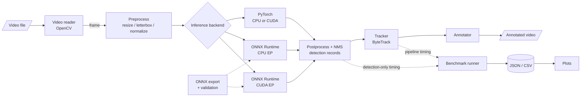

# Architecture (planned)

> **Status:** mostly a design document. Implemented so far: **Configuration** (`config.py`), the environment-report part of **Device detection** (`device.py`), **Video input** (`video/reader.py`), the **Backend interface** (`models/base.py`), the **PyTorch backend** (`models/pytorch_backend.py`; its own `auto`/`cpu`/`cuda` device selection) the detection part of the **Pipeline** (`pipeline.py`, with JSON output in `results.py`), **Video output** with annotation (`video/annotator.py`, `video/writer.py`), and **Tracking** (`tracking/`). Every other component below is planned.

## Data flow

## Components

| Component | Planned module | Responsibility |
|-----------|----------------|----------------|
| Configuration | `config.py` | Load and validate YAML experiment configs; record the resolved config with every result |
| Device detection | `device.py` | Report Python, PyTorch, OpenCV, ONNX Runtime, OS, CPU, GPU and CUDA details; list available execution providers; select a device without silently changing a requested one |
| Video input | `video/reader.py` | Open a video, stream frames sequentially, expose FPS/size/frame count, apply a frame limit, raise clear errors for missing or corrupt files |
| Annotation | `video/annotator.py` | *Implemented:* draw boxes and `class confidence` labels on a copy of a frame; boxes clipped to the frame; fixed colour per class ID. No model or file I/O. Track IDs are planned with tracking |
| Video output | `video/writer.py` | *Implemented:* write frames with OpenCV (`mp4v`), validating fps, size (even only) and every frame; write to `.partial.mp4` and rename on success; release and clean up on error. Output FPS: override, else source, else 30 with a warning |
| Backend interface | `models/base.py` | `Detection` record, shared `DetectionSettings` (input size, thresholds, class filter), `Detector` protocol (`detect(frame, frame_index) -> list[Detection]`), frame validation, detector error types |
| PyTorch backend | `models/pytorch_backend.py` | `PytorchYoloDetector`: load pretrained Ultralytics YOLO weights, choose `auto`/`cpu`/`cuda` (never silently downgrading an explicit CUDA request), run Ultralytics' preprocessing, inference and NMS, convert results to `Detection` records |
| ONNX backend | `models/onnx_backend.py`, `models/factory.py` | *Implemented:* `OnnxYoloDetector` loads one ONNX Runtime session per detector and checks the model's input/output layout and metadata. It chooses execution providers explicitly (`cpu` = CPU only; `auto` = CUDA if the build offers it, else CPU; `cuda` = CUDA or an error) and reports the providers the session **actually** activated, so a silent CPU fallback is detected. Preprocessing, decoding and NMS mirror Ultralytics' (`letterbox` with square padding, best class per candidate, strict `score > conf`, per-class NMS with a class offset, at most 300 boxes); models with built-in NMS are recognised and NMS is not repeated. `create_detector(backend, ...)` lets the commands switch backends with `--backend` |
| Export | `models/export.py`, `models/onnx_validation.py` | *Implemented:* `export_onnx()` exports a local `.pt` detection model with Ultralytics' `model.export(format="onnx", device="cpu")` from a temporary copy (so nothing is written beside the weights), checks the export packages first (Ultralytics would otherwise pip-install them), and publishes via `.partial.onnx` + rename, refusing to overwrite unless asked. `validate_onnx()` runs `onnx.checker.check_model(full_check=True)` and reports inputs, outputs, opset and metadata; `yolo_layout_problems()` checks the YOLO layout. *Planned:* numerical agreement with PyTorch and finite-value checks |
| Tracking | `tracking/base.py`, `tracking/bytetrack.py` | *Implemented:* `TrackedDetection` (a `Detection` plus `track_id`) and a `Tracker` protocol (`update(detections, frame)` returns the same detections in the same order, adding IDs; `reset()`). `ByteTrackTracker` adapts Ultralytics' `BYTETracker`: our detections go in as Ultralytics `Boxes`, and its detection indices map IDs back to the original records. It runs after any detector, so there is no second inference. The pipeline resets it per video and checks that it only adds IDs. IDs are not persistent identities |
| Benchmarking | `benchmarks/runner.py`, `stats.py`, `report.py` | *Implemented:* `run_benchmark()` creates a fresh detector per run through `create_detector()` (initialisation timed), runs untimed warm-up iterations, then timed iterations with `time.perf_counter()`: `detector` scope = `detect()` on preloaded frames (plus the stage times each detector records in `last_timings`); `pipeline` scope = decode + detect (+ track) per video frame, each timed separately. Statistics are pure Python (linear-interpolation percentiles, sample stdev). Results are JSON (`edgevision.benchmark` v1) with environment, file hashes and timing definitions, written atomically. The detectors' only benchmark-related additions are `last_timings` and the opt-in PyTorch `letterbox="square"` |
| Evaluation | `evaluation/detection_metrics.py`, `annotations.py`, `agreement.py`, `benchmark_plots.py` | *Implemented:* IoU, per-image greedy matching (highest confidence first, same class, IoU >= t, crowd regions by intersection-over-detection), TP/FP/FN, precision/recall/F1, COCO 101-point AP and mAP@0.5 / @0.5:0.95 (identical to `pycocotools` on synthetic data). A COCO JSON loader maps categories to model classes by name. Agreement between two `detect_video` outputs uses the same matching. Benchmark plots validate the JSON files, never replace missing values with 0 or drop outliers, and print workload differences on every figure. No labelled data is shipped, so accuracy has not been measured |
| Pipeline | `pipeline.py` | *Implemented:* `VideoDetectionPipeline` feeds frames from the reader to any `Detector`, yields per-frame `FrameDetections`, checks frame indices, keeps only counters for a `PipelineSummary`, and releases the video on every exit path. Each result also carries its decoded frame, so the annotator → writer stage is driven by `scripts/detect_video.py --output-video`. An optional `Tracker` runs between detection and annotation (reset at the start of each video) |
| Detection results | `results.py` | *Implemented:* stream per-frame detections to JSON (`edgevision.video_detections` v1), written to `.partial` and atomically renamed when complete |

Module names follow the long-term plan and may change if there is a clear technical reason. Modules will be added only when they are implemented.

## Detection record contract

Implemented as the frozen dataclass `edgevision.models.Detection`; values are validated when a record is created.

Every backend will return the same record format so downstream stages (tracking, evaluation, comparison) are backend-agnostic:

| Field | Type | Convention |
|-------|------|------------|
| `frame_index` | int | 0-based index in the source video |
| `bbox_xyxy` | 4 floats | `x1, y1, x2, y2` in source-frame pixel coordinates, `x1 <= x2`, `y1 <= y2` |
| `confidence` | float | Post-NMS score in `[0, 1]` |
| `class_id` | int | Model class index |
| `class_name` | str | Human-readable class label |

## Consistency between backends

The PyTorch and ONNX Runtime backends must share model weights, input resolution, confidence and IoU thresholds, and class filtering. Where feasible, preprocessing and postprocessing (including NMS) should be shared code. Any difference that cannot be eliminated will be documented here and in the experiment log.

**Known difference: input padding.** For a `.pt` model, Ultralytics pads each frame only to the next multiple of 32 (a 1024×576 frame becomes 640×384). A fixed-size ONNX model always gets the full 640×640 square. The network therefore sees slightly different images and the detections differ slightly; on the 113-frame sample clip this meant 395 (PyTorch) vs 426 (ONNX) detections. With identical square inputs, the two agreed to within 0.0001 px on boxes and 10⁻⁶ on scores on three test images. The PyTorch backend was not changed to hide this; fair comparisons must feed both backends the same input size and padding.
