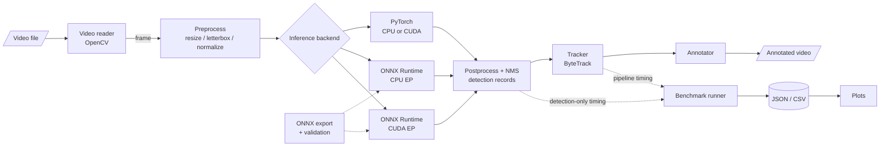

# Architecture (planned)

> **Status:** mostly a design document. Implemented so far: **Configuration** (`config.py`), the environment-report part of **Device detection** (`device.py`), and **Video input** (`video/reader.py`). Device *selection* and every other component below are planned.

## Data flow

## Components

| Component | Planned module | Responsibility |
|-----------|----------------|----------------|
| Configuration | `config.py` | Load and validate YAML experiment configs; record the resolved config with every result |
| Device detection | `device.py` | Report Python, PyTorch, OpenCV, ONNX Runtime, OS, CPU, GPU and CUDA details; list available execution providers; select a device without silently changing a requested one |
| Video input | `video/reader.py` | Open a video, stream frames sequentially, expose FPS/size/frame count, apply a frame limit, raise clear errors for missing or corrupt files |
| Video output | `video/writer.py` | Write annotated frames; always release resources, including on error |
| Backend interface | `models/base.py` | Common interface shared by all inference backends |
| PyTorch backend | `models/pytorch_backend.py` | Load pretrained weights, run in eval mode with gradients disabled, CPU or CUDA |
| ONNX backend | `models/onnx_backend.py` | Run the exported model with ONNX Runtime; verify which execution provider was actually selected |
| Export | `models/export.py` | Export weights to ONNX with a documented opset; check loading, output shapes, finite values, and numerical agreement with PyTorch |
| Tracking | `tracking/tracker.py` | Wrap an existing ByteTrack implementation; assign persistent track IDs; kept separate from detection |
| Benchmarking | `benchmarks/` | Timing primitives, run orchestration, statistics, JSON/CSV reporting |
| Evaluation | `evaluation/detection_metrics.py` | IoU matching, precision/recall/F1, and mAP only where the protocol and annotations support it |
| Pipeline | `pipeline.py` | Compose reader → backend → tracker → annotator → writer |

Module names follow the long-term plan and may change if there is a clear technical reason. Modules will be added only when they are implemented.

## Detection record contract

Every backend will return the same record format so downstream stages (tracking, evaluation, comparison) are backend-agnostic:

| Field | Type | Convention |
|-------|------|------------|
| `frame_index` | int | 0-based index in the source video |
| `bbox` | 4 floats | `x1, y1, x2, y2` in source-frame pixel coordinates |
| `confidence` | float | Post-NMS score in `[0, 1]` |
| `class_id` | int | Model class index |
| `class_name` | str | Human-readable class label |

## Consistency between backends

The PyTorch and ONNX Runtime backends must share model weights, input resolution, confidence and IoU thresholds, and class filtering. Where feasible, preprocessing and postprocessing (including NMS) should be shared code. Any difference that cannot be eliminated will be documented here and in the experiment log.
