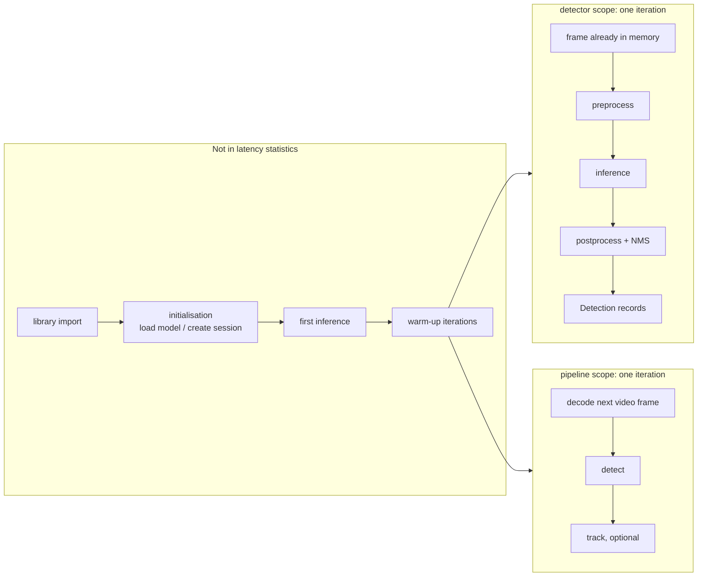

# Benchmarking methodology

`scripts/benchmark.py` measures how long a detection backend takes, under stated and recorded conditions, and saves every measurement as JSON. `scripts/compare_benchmarks.py` shows results side by side and lists every setting that differs between them.

> [!WARNING]
> **A benchmark result describes one machine, one model, one input and one set of settings.** It changes with the CPU or GPU, power mode, temperature, background programs, operating system, Python and library versions, model file, input size, thresholds, and the frames used. The only recorded results (CPU, one laptop) are in [`experiment_log.md`](experiment_log.md); nothing here claims that one backend is faster in general.

## Quick start (Windows, Command Prompt, from the repository root)

```bat
.venv\Scripts\activate.bat
python -m pip install -e ".[dev,vision,detector,onnxruntime]"

:: PyTorch on the CPU (config defaults: data\input\sample.mp4, 20 warm-up + 300 measured iterations, 3 runs)
python scripts\benchmark.py --backend pytorch --device cpu --output results\benchmarks\pytorch_cpu.json

:: ONNX Runtime on the CPU (needs models\yolov8n.onnx from scripts\export_onnx.py)
python scripts\benchmark.py --backend onnx --device cpu --output results\benchmarks\onnx_cpu.json

:: Side by side
python scripts\compare_benchmarks.py results\benchmarks\pytorch_cpu.json results\benchmarks\onnx_cpu.json
```

Shorter runs for a quick check: `--warmup 5 --iterations 50 --runs 1`. Without `--output`, results are saved as `results\benchmarks\<backend>_<device>_<scope>_<date-time>.json`. An existing file is never replaced unless `--overwrite` is given.

## What is measured



| Metric (JSON key) | What is inside the timed region | What is not |
|-------------------|---------------------------------|-------------|
| `library_import.seconds` | Importing PyTorch + Ultralytics, or ONNX Runtime; once per process | Everything else. Near zero if already imported (`already_imported`) |
| `init_s` (per run) | Creating the detector: loading the `.pt` model / creating the ONNX Runtime session, checking the model | Library import, first inference |
| `first_inference_ms` (per run) | The first `detect()` call after initialisation | Not part of any statistic. It is often much slower (memory allocation, Ultralytics' internal warm-up) |
| `warmup_s` (per run) | All warm-up iterations | Excluded from every statistic |
| `latency_ms.detect` | One `detect()` call: preprocessing (letterbox, colour conversion, tensor), inference, postprocessing (decoding, NMS, scaling boxes), building `Detection` records | Video decoding, tracking, drawing, file writing |
| `latency_ms.preprocess_ms`, `inference_ms`, `postprocess_ms` | The three stages of the same `detect()` calls, as reported by the backend (see below) | Input validation, conversion to `Detection` records |
| `latency_ms.decode` (pipeline) | Reading and decoding the next frame with OpenCV | Detection |
| `latency_ms.track` (pipeline, `--tracking`) | ByteTrack association for the frame | Detection |
| `latency_ms.frame` (pipeline) | decode + detect (+ track) for one frame | Drawing, video writing, JSON |
| `throughput_fps` (per run) | Measured iterations ÷ wall-clock time of the whole measured loop | Warm-up, initialisation |

**Statistics** for every latency: `count`, `mean`, `median` (p50), `p90`, `p95`, `min`, `max`, `stdev`.
- `stdev` is the sample standard deviation (divides by n − 1). It is `null` for a single sample; it is never reported as 0.
- Percentiles use linear interpolation between the nearest ranks, the same rule as NumPy's default.
- With fewer than 20 measured iterations the command warns that p90/p95 are unreliable.
- The raw per-iteration samples are stored too (`runs[].samples_ms`), so any other statistic can be computed later.

**Throughput is not 1000 ÷ mean latency.** It is measured directly over the measured loop, frames processed one after another (batch size 1). It includes the small loop overhead between calls, and in the pipeline scope it includes decoding and tracking.

### Stage timings: who measures them

- **ONNX Runtime:** EdgeVision measures them with `time.perf_counter()`:
  - preprocess = letterbox + tensor;
  - inference = `session.run()`, including ONNX Runtime's own copies of inputs and outputs;
  - postprocess = decoding, NMS, box restoration.
- **PyTorch:** Ultralytics measures them (`Results.speed`, also `time.perf_counter()`, with GPU synchronisation when a GPU is used):
  - preprocess = letterbox + tensor;
  - inference = forward pass;
  - postprocess = NMS, scaling boxes, building Ultralytics' result objects.

The stage boundaries are therefore close but not identical. `latency_ms.detect` is the number with exactly the same boundary for both backends. The stages do not add up exactly to `detect`: input validation, conversion to `Detection` records, and (PyTorch) Ultralytics' per-call setup sit outside them. If a backend does not report stages, they are marked unavailable in the run's `notes`, never filled in.

### Timer and synchronisation

- Every time comes from `time.perf_counter()`, a monotonic high-resolution clock.
- CPU inference is synchronous, and both backends return their results as CPU data (NumPy arrays, Python lists). A `detect()` call therefore cannot return before the work is finished, so no extra synchronisation is added.
- On an NVIDIA GPU:
  - ONNX Runtime's `session.run()` also returns only after copying outputs back to the CPU;
  - Ultralytics synchronises the GPU for its stage timings;
  - EdgeVision copies PyTorch's boxes to the CPU inside `detect()`.

## Scopes

| `--scope` | Input | Each iteration |
|-----------|-------|----------------|
| `detector` (default) | Image or video. An image is reused for every iteration; a video contributes its first `--preload-frames` frames (default 32), decoded **before** timing starts and used in rotation | `detect()` on a frame in memory: no file reading or decoding inside any measurement |
| `pipeline` | Video only | Read and decode the next frame, then `detect()`, then (with `--tracking`) ByteTrack. Each run starts again from the first frame. The first `--warmup` frames are warm-up. If the video ends early, fewer frames are measured, and the count and a note are recorded |

## Runs, warm-up and iterations

| Option | Default (`configs/default.yaml`, section `benchmark`) | Meaning |
|--------|-----------------------------------------------------|---------|
| `--warmup N` | 20 | Iterations per run that run normally but are excluded from all statistics. 0 is allowed; the first measured iteration then includes one-off setup costs, and the result says so |
| `--iterations N` | 300 | Measured iterations per run |
| `--runs N` | 3 | Independent runs. **Each creates a new detector**, so initialisation is measured every time; within a run the same detector (model, session) is reused for every iteration |
| `--preload-frames N` | 32 | Detector scope with a video: distinct frames held in memory |
| `--scope` | `detector` | See above |
| `--device` | `auto` | `cpu`, `cuda` or `auto`, as for the detection commands. The device and providers actually used are recorded |

Detection settings come from the `model` section and the usual options: `--model`, `--imgsz`, `--conf`, `--iou`. The class filter comes from `model.classes`.

## Fair comparison of PyTorch and ONNX Runtime

1. **Same input and settings.** Use the same image or video, `--imgsz`, `--conf`, `--iou` and class filter, the same `--scope`, `--warmup`, `--iterations`, `--runs` and `--preload-frames`. Use the same machine, power mode and plugged-in state.
2. **Same input tensor.** For a `.pt` model, Ultralytics normally pads a frame only to the next multiple of 32 (a 1024×576 frame becomes 640×384). The exported ONNX model always needs the full 640×640 square. The benchmark therefore runs PyTorch with **square** padding by default (`--pytorch-letterbox square`), so both backends process an identical 1×3×640×640 tensor and return the same detections. `--pytorch-letterbox minimal` measures what `detect_video.py` does by default instead. That is a smaller tensor and less work, so it is not an equal comparison. The JSON records `model_input_shape` either way.
3. **Check that the workload matched.** `detections_total` per run should be equal (or very close) between backends on the same input. A large difference means different work was timed.
4. **Run each backend in its own command**, one after the other, and don't run other heavy programs meanwhile. Running each in a separate process keeps the libraries' thread pools from interfering.
5. **Compare with `compare_benchmarks.py`.** It lists every setting that differs. Treat any listed difference as a reason the numbers are not directly comparable.
6. **Never compare across hardware as if it were equal.** A GPU result and a CPU result, or two different machines, measure different things.
7. **Remember what differs by design:**
   - preprocessing code (Ultralytics vs EdgeVision);
   - the location of NMS (inside Ultralytics vs EdgeVision's NumPy implementation);
   - each library's default thread count.

   These affect speed, and slightly affect detections.

The tools never declare a winner. They produce evidence; interpretation belongs in `docs/experiment_log.md`, with the result files.

## This laptop: CPU only

The development laptop (AMD Ryzen 7 5700U, no NVIDIA GPU) can only produce CPU results. `--device cuda` fails with an explanation, and `--device auto` runs on the CPU; the result's `warnings` say so. Laptop CPUs change clock speed with power mode, battery vs mains power and temperature. For more stable numbers:

- plug the laptop in;
- use the same Windows power mode for every run;
- close other heavy programs;
- use several runs;
- look at the run-to-run spread (`detect_median_ms_per_run`, `throughput_fps_per_run`).

None of these conditions are recorded automatically.

**Keep the computer awake for the whole run.** On Windows the timer keeps counting while the computer sleeps, so a laptop that goes to sleep mid-benchmark records an "iteration" lasting minutes or hours. Before a long run, set *Settings → System → Power → Screen and sleep* to *Never* while plugged in, and don't close the lid.

The tool flags such iterations automatically: any iteration more than 10× the run's median **and** longer than 1 s is listed in `runs[].suspect_iterations`. The samples are kept unchanged, never deleted. A loud `WARNING` appears in the summary and in `warnings`, and `compare_benchmarks.py` marks the file as not reliable. Ordinary jitter (a few times the median) is not flagged. If you see the warning, rerun that benchmark with `--overwrite`. The median of a disturbed run is usually still close to normal, but the mean, max, stdev and throughput are not.

## Result files

Schema `edgevision.benchmark`, version 1. Fields are documented in [`results/README.md`](../results/README.md).

- **Environment:** OS, Python, CPU model and cores, NVIDIA GPUs, package versions, the backend's own details (PyTorch version, CUDA availability and threads, or ONNX Runtime version and providers), and the git commit.
- **Privacy:** paths are stored relative to the repository, or as a file name only, never as absolute paths. The Python executable path and the user name are not stored.
- **File identity:** the model and input are identified by size and SHA-256.
- **Writing:** the file is written to `NAME.partial` and renamed when complete. Nothing is written if a run fails or is interrupted (Ctrl+C). No model weights or video data are stored, only timings and metadata (about 120 KB for 3 × 300 iterations).

`results/` is git-ignored. To keep a result, copy its key numbers into `docs/experiment_log.md`, together with the file name and the conditions above.

## Limitations

- Batch size 1 and FP32 only. Memory use is not measured.
- Thread counts are the libraries' defaults and may differ between PyTorch and ONNX Runtime. They are recorded where available.
- Python's garbage collector stays enabled, as in normal use.
- Power mode, temperature and background load are not controlled or recorded.
- Detection counts in a result only confirm the workload; they say nothing about accuracy.
