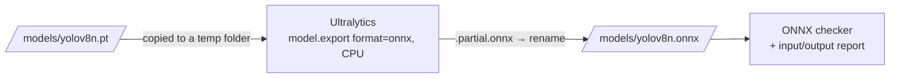
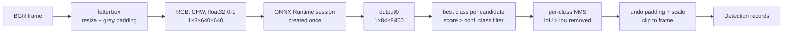

# ONNX export and ONNX Runtime inference

How the YOLO model is exported to ONNX, validated, and run with ONNX Runtime, and how the ONNX backend's results relate to PyTorch's. The [README](../README.md) has the quick start.

## Export and validation

**What ONNX is.** A trained PyTorch model is Python code plus weights, so it needs PyTorch to run. [ONNX](https://onnx.ai/) (Open Neural Network Exchange) is a file format that stores the model as a graph of standard operations (convolution, addition, sigmoid, …) together with its weights. Other runtimes, such as ONNX Runtime, TensorRT or OpenVINO, can load that file without PyTorch. Exporting to ONNX is the first step towards comparing PyTorch with ONNX Runtime. Export and structural checks are described here; running the file is covered in [ONNX Runtime inference](#onnx-runtime-inference).



Install the `export` extra **together with** `detector` (export needs PyTorch and Ultralytics) and `onnxruntime` (used to simplify the graph):

```bat
python -m pip install -e ".[dev,vision,detector,tracking,export,onnxruntime]"
```

Then, on Windows (Command Prompt or PowerShell, venv activated, from the repository root):

```bat
:: 1. Make sure the PyTorch weights exist (the first detection run downloads them). Export never downloads.
dir models\yolov8n.pt

:: 2. Export with the config defaults: models\yolov8n.pt -> models\yolov8n.onnx, 640x640, then validate
python scripts\export_onnx.py

:: 3. Re-check or describe the file at any time
python scripts\inspect_onnx.py models\yolov8n.onnx --imgsz 640
```

Choosing what to export (defaults come from `configs/default.yaml`):

| Option | Default (config field) | Meaning |
|--------|------------------------|---------|
| `--model PATH` | `models/yolov8n.pt` (`model.weights`) | Source `.pt` file. Must already exist. |
| `--output PATH` | `models/yolov8n.onnx` (`model.onnx_path`) | Where to write the `.onnx` file; missing folders are created. |
| `--imgsz N` | `640` (`model.input_size`) | Square input size baked into the graph; a multiple of 32. |
| `--opset N` | Ultralytics' choice (`export.opset: null`) | ONNX operator-set version. With PyTorch 2.14, Ultralytics picks 18. |
| `--dynamic` | off (`export.dynamic_shapes`) | Allow any batch size and image size instead of fixed `1×3×N×N`. |
| `--no-simplify` | simplify on | Skip onnxslim graph simplification (then only `onnx` is needed). |
| `--no-validate` | validate (`export.validate`) | Skip the structural check after export. |
| `--overwrite` | off | Replace an existing output file. Without it, export refuses. |

For example: `python scripts\export_onnx.py --imgsz 320 --output models\yolov8n_320.onnx`.

What happens during export:

- **CPU only, nothing downloaded.** The source must be a local `.pt` file; a missing file is an error, not a download. Export runs with `device="cpu"`.
- **No surprise installs.** Ultralytics pip-installs missing export packages at export time. EdgeVision checks for `onnx`, `onnxslim` and an ONNX Runtime package first and stops with an install hint instead.
- **No files next to your weights.** Ultralytics always writes `<weights>.onnx` beside the `.pt` file. EdgeVision gives it a copy of the weights in a temporary folder, so its log mentions a temporary path; the result is then copied to `PATH.partial.onnx` and renamed to the requested path. A failed export leaves no output and keeps any previous file.
- **Graph contents.** The model is exported as Ultralytics exports it by default: FP32, batch 1, and **without non-maximum suppression** inside the graph. The single output `output0` has shape `[1, 84, 8400]`: for each of 8,400 candidate boxes (from the 80×80, 40×40 and 20×20 grids at 640×640), 4 box values (centre x, centre y, width, height, in input pixels) followed by 80 class scores. The ONNX Runtime backend does the decoding and NMS. At 320×320 there are 2,100 candidates.
- **Output.** `Exported: models/yolov8n.onnx (12.3 MiB, 12,851,106 bytes)`, then the validation result.

**Structural validation vs numerical parity.** These are two different questions:

| | Structural validation (`inspect_onnx.py`) | Numerical parity (opt-in test, `compare_detections.py`) |
|---|---|---|
| Question | Is this a well-formed ONNX model with the expected inputs and outputs? | Does it produce the same numbers as the PyTorch model? |
| How | `onnx.checker.check_model(full_check=True)`, then read input/output names, types and shapes, and check the YOLO layout | Run both backends on the same input tensors and compare detections: an opt-in test (boxes within 0.01 px of Ultralytics running the same file) and `compare_detections.py` on whole videos |
| Catches | Corrupt or truncated files, invalid graphs, wrong input size, wrong number of classes | Wrong preprocessing, numerical drift, broken operators |

Passing structural validation therefore does **not** mean the ONNX model gives the same detections as PyTorch. The commands say so in their output.

`inspect_onnx.py` prints a report like this (real output from the Linux run):

```text
ONNX structural validation: PASSED (official ONNX checker, full check)
  File        models/yolov8n.onnx (12.3 MiB, 12,851,106 bytes)
  Opset       18 (IR version 8)
  Producer    pytorch 2.14.1
  Input       images: FLOAT [1, 3, 640, 640]
  Output      output0: FLOAT [1, 84, 8400]
  Metadata    task detect, imgsz [640, 640], 80 classes, Ultralytics 8.4.178
  YOLO layout as expected: (batch, 3, H, W) in, (batch, 4 + classes, candidates) out
  Note: structural checks only. Matching PyTorch results requires a numerical comparison.
```

Exit status for both commands: 0 success, 1 failure (missing model or package, existing output, export or validation failure, unexpected layout), 2 invalid arguments. `--help` only prints help; it never exports.

Common errors:

| Message | Cause and fix |
|---------|---------------|
| `Model file not found: models/yolov8n.pt` | Export never downloads. Run `python scripts\detect_image.py <any image>` once, or pass `--model`. |
| `models\yolov8n.onnx already exists; use overwrite=True (--overwrite) to replace it` | Protection against silently replacing a file. Add `--overwrite` or choose another `--output`. |
| `onnx is required to export ONNX models but is not installed` (or `onnxslim`) | Install the extra: `python -m pip install -e ".[export]"`. |
| `An ONNX Runtime package is required to simplify the exported model ...` | `python -m pip install -e ".[onnxruntime]"`, or export without simplification: `--no-simplify`. |
| `onnx 1.11.0 is installed, but Ultralytics' exporter needs onnx>=1.12.0,<2.0.0` | Upgrade by reinstalling the extra. |
| `PyTorch is required to export models ...` / `Ultralytics is required ...` | Install the `detector` extra too. |
| `input_size must be ... a multiple of 32` (exit 2) | YOLO's grids need sizes such as 320, 480, 640. |
| `... is not a valid ONNX model: ...` | The file is truncated, corrupt, or not ONNX. Export it again with `--overwrite`. |
| `YOLO layout NOT as expected` | The file is valid ONNX but not the expected detection model, e.g. exported at another size (`--imgsz`) or a segmentation model. |

**ONNX Runtime and export.** Graph simplification (the default) needs an ONNX Runtime package, so install `export` together with `onnxruntime` (or `onnxruntime-gpu`, never both). `export` does not include it, so that GPU users are not forced to install the conflicting CPU package.

**Git.** `.onnx` files are ignored by `.gitignore` (`*.onnx`, which also covers `*.partial.onnx`), like the `.pt` weights. Do not commit them: they are 12 MB build outputs that anyone can regenerate with `export_onnx.py`. Check with `git status` that `models/yolov8n.onnx` does not appear.

## ONNX Runtime inference

`--backend onnx` runs the exported `.onnx` file with [ONNX Runtime](https://onnxruntime.ai/) instead of PyTorch. Everything else stays the same: the same commands and options, the same `Detection` records, the same tracking, annotated video and JSON output. PyTorch remains the default, and ONNX inference does not need PyTorch or Ultralytics installed.



**Install** (CPU; Windows, Linux or macOS):

```bat
python -m pip install -e ".[dev,vision,onnxruntime]"
```

That is enough to run an existing `.onnx` file. To export one as well, also install `detector` and `export` (the full command is in the [README](../README.md#installation-windows)).

**Run** (Windows Command Prompt, from the repository root, after `python scripts\export_onnx.py`):

```bat
python scripts\detect_image.py data\input\photo.jpg --backend onnx --device cpu
python scripts\detect_video.py data\input\sample.mp4 --backend onnx --device cpu --json results\sample_onnx.json
python scripts\detect_video.py data\input\sample.mp4 --backend onnx --tracking --output-video results\sample_onnx_tracked.mp4
```

- **Model path.** With `--backend onnx`, `--model` defaults to `model.onnx_path` in `configs/default.yaml` (`models/yolov8n.onnx`). Pass `--model path\to\other.onnx` to use another file. The file must already exist; ONNX models are never downloaded.
- **Input size.** A model exported with a fixed size (the default) only accepts that size. If `--imgsz` (or `model.input_size`) differs, the command stops and says which size to use. Models exported with `--dynamic` accept any multiple of 32.
- **Guard against mixing backends.** `--backend pytorch` with an `.onnx` file, or `--backend onnx` with a `.pt` file, is refused (exit 2). Ultralytics would otherwise load an `.onnx` file through ONNX Runtime while EdgeVision reported "pytorch".

**Execution providers.** ONNX Runtime runs a model through an *execution provider*: `CPUExecutionProvider` on the processor, `CUDAExecutionProvider` on an NVIDIA GPU. EdgeVision always requests providers explicitly:

| `--device` | Requested | If CUDA is not usable |
|------------|-----------|-----------------------|
| `cpu` | CPU only | n/a |
| `auto` (default) | CUDA then CPU if this ONNX Runtime build offers CUDA, else CPU | Runs on the CPU and logs a warning |
| `cuda` | CUDA then CPU | Stops with an error, never silently uses the CPU |

After loading, EdgeVision asks the session which providers it **actually** activated. ONNX Runtime silently falls back to the CPU when the CUDA libraries are missing; EdgeVision detects this and reports `device: cpu`. The summary line shows the active providers, e.g. `ONNX Runtime 1.31.0, providers: CPUExecutionProvider, device: cpu`, and JSON results record them as `execution_providers`. `python -m edgevision.device` lists the providers your installation offers.

**GPU runtime (not tested in this project).** The `onnxruntime` package is CPU-only. On a machine with an NVIDIA GPU, replace it with the GPU build, which also includes the CPU provider:

```bat
python -m pip uninstall -y onnxruntime
python -m pip install -e ".[onnxruntime-gpu]"
python -m edgevision.device
```

Never install both: they contain the same `onnxruntime` module and overwrite each other. `onnxruntime-gpu` also needs CUDA and cuDNN versions that match its release (see the ONNX Runtime documentation). If they are missing, `--device cuda` fails with an explanation and `--device auto` runs on the CPU. No GPU was available to test this path here.

**Supported models.** YOLO detection models exported by `scripts/export_onnx.py`, with:

- one float32 input `(batch, 3, H, W)` with batch 1 or dynamic, and a square size, fixed or dynamic;
- class names in the file's metadata (Ultralytics writes them);
- one output in either of two layouts:
  - **raw** `(1, 4 + classes, candidates)`, the default export, e.g. `(1, 84, 8400)`. EdgeVision applies the threshold and class filter, then per-class NMS.
  - **NMS included** `(1, N, 6)` with rows `x1, y1, x2, y2, score, class` (Ultralytics `nms=True`, or end-to-end models). Only the threshold and class filter are applied, so NMS never runs twice. The IoU threshold and the 300-box limit were fixed at export time, so `--iou` has no effect; EdgeVision logs this.

Anything else, including FP16/INT8 inputs, segmentation or pose models, or other output shapes, is rejected when the model loads, with a message saying why.

### Preprocessing and postprocessing, step by step

The PyTorch backend lets Ultralytics prepare frames and interpret the output. ONNX Runtime only runs the network, so EdgeVision does those steps itself, following Ultralytics' rules exactly:

1. **Letterbox.** The network expects a square image, e.g. 640×640. The frame is shrunk (or enlarged) by the same factor in both directions, so a 1024×576 frame becomes 640×360. Rows of grey (114) pad it to 640×640: 140 above and 140 below. Stretching the frame instead would distort object shapes.
2. **Colour order and layout.** OpenCV stores pixels as BGR; the model was trained on RGB, so the channels are reversed. The array is reordered from height×width×channels to channels×height×width, the layout the network uses.
3. **Scaling.** Pixel values 0–255 become float32 values 0–1, and a batch dimension is added: `1×3×640×640`.
4. **Decoding.** The raw output holds 8,400 candidate boxes, from grids of 80×80, 40×40 and 20×20 cells. Each has 4 box values (centre x, centre y, width, height, in input pixels) and 80 class scores. For each candidate, the best class is kept. Candidates whose score is not above `--conf` are dropped, and so are classes outside the class filter.
5. **Non-maximum suppression.** Neighbouring candidates often describe the same object. Starting with the highest score, any box of the **same class** that overlaps a kept box by more than `--iou` (intersection over union) is removed. At most 300 boxes are kept.
6. **Back to the original frame.** The padding is subtracted, coordinates are divided by the scale factor, and boxes are clipped to the frame. The result is `x1, y1, x2, y2` in original pixels, like every other backend.

Tests compare steps 1 and 4–5 with Ultralytics' own code on random inputs, and the opt-in real test compares the full ONNX backend with Ultralytics running the same `.onnx` file.

### Why PyTorch and ONNX results differ, and how to make them identical

With default settings the two backends return slightly different detections. The cause is one preprocessing difference:

- **PyTorch backend** (Ultralytics with a `.pt` model): pads only up to the next multiple of 32 by default. A 1024×576 frame becomes a 640×384 input.
- **ONNX backend**: the exported model has a fixed 640×640 input, so the frame is padded to a full square.

The network sees a different image, so its output differs. `--pytorch-letterbox square` gives PyTorch the same square input. Measured on all 113 frames of the sample clip (Linux, CPU, YOLOv8n):

| PyTorch padding | PyTorch detections | ONNX detections | Matched (same class, IoU ≥ 0.5) | Largest differences |
|-----------------|-------------------:|----------------:|--------------------------------:|---------------------|
| default (640×384) | 395 | 426 | 386 | 9 found only by PyTorch, 40 only by ONNX |
| `--pytorch-letterbox square` (640×640) | 426 | 426 | 426 (every frame) | box 0.0003 px, score 3×10⁻⁶ |

So with identical inputs, EdgeVision's own ONNX pre- and postprocessing reproduces Ultralytics' results to floating-point precision. The default PyTorch padding was left unchanged because it is Ultralytics' normal behaviour (and a smaller input is faster); benchmarks use square padding for both backends by default. Neither set of detections is "more correct": that needs labelled ground truth.

```bat
python scripts\detect_video.py data\input\sample.mp4 --pytorch-letterbox square --json results\pt_square.json
python scripts\detect_video.py data\input\sample.mp4 --backend onnx --json results\onnx.json
python scripts\compare_detections.py results\pt_square.json results\onnx.json
```

**Smoke test** (real model, CPU; needs `vision`, `detector` and `onnxruntime`, and `models/yolov8n.onnx`). This checks EdgeVision's ONNX backend against Ultralytics running the same file:

```bat
set EDGEVISION_RUN_MODEL_TESTS=1
python -m pytest tests\test_onnx_backend.py -m model -v
set EDGEVISION_RUN_MODEL_TESTS=
```
