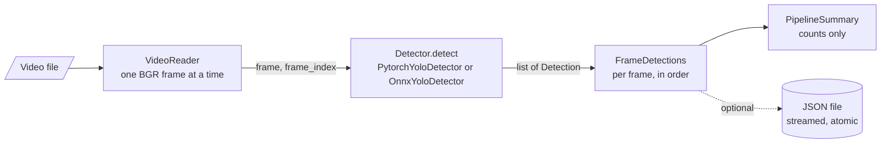
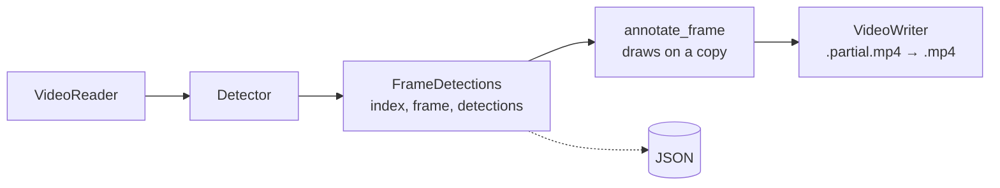
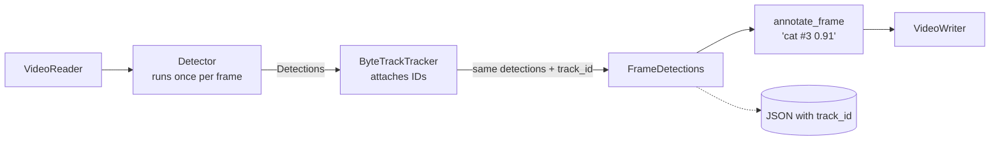

# Detection, video output and tracking

Details of the detection commands and the Python API. The [README](../README.md) has the quick start; ONNX export and the ONNX Runtime backend are in [`onnx.md`](onnx.md).

## Detection commands

`detect_image.py` takes its model, input size, thresholds and class filter from `configs/default.yaml`; `--model`, `--imgsz`, `--conf` and `--iou` override them. `--device` is `auto` (CUDA only if PyTorch can use it, otherwise CPU), `cpu`, or `cuda` (fails with an explanation if CUDA is unavailable). `--backend onnx` runs an exported model instead ([`onnx.md`](onnx.md)). `--pytorch-letterbox square` makes the PyTorch backend pad frames to the full square input, like the ONNX model, instead of Ultralytics' default minimal padding; the JSON records which was used (`letterbox`). `--json` refuses to replace an existing file unless `--overwrite` is given. Exit status is 0 on success, 1 if the image, model or inference fails, and 2 for invalid arguments.

Reading video and detecting objects from Python:

```python
from edgevision.models import DetectionSettings, PytorchYoloDetector
from edgevision.video import VideoReader

with VideoReader("data/input/sample.mp4", max_frames=100) as reader:
    print(reader.metadata)            # width, height, fps, frame_count, fourcc (None if unknown)
    for frame_index, frame in reader:  # frame: BGR uint8 array, shape (height, width, 3)
        ...
print(reader.frames_read, reader.stop_reason)  # e.g. 100 StopReason.MAX_FRAMES

settings = DetectionSettings(input_size=640, conf_threshold=0.25, iou_threshold=0.7)
with PytorchYoloDetector("models/yolov8n.pt", device="auto", settings=settings) as detector:
    for d in detector.detect(frame, frame_index=0):  # any BGR uint8 frame
        print(d.class_name, round(d.confidence, 2), d.bbox_xyxy)  # box in original-image pixels
```

## The detection interface

Every backend returns the same `Detection` records, so later stages (tracking, drawing, evaluation, PyTorch-vs-ONNX comparison) never depend on library-specific output:

| Field | Meaning |
|-------|---------|
| `frame_index` | Zero-based index of the frame the detection came from |
| `bbox_xyxy` | `(x1, y1, x2, y2)`: top-left and bottom-right corners in pixels of the **original** frame (not the resized model input) |
| `confidence` | Score in `[0, 1]` after non-maximum suppression |
| `class_id`, `class_name` | Model class index and label, e.g. `15`, `"cat"` (COCO classes for the pretrained model) |

Records are validated when created (finite numbers, confidence in range, non-negative integer IDs, `x1 <= x2` and `y1 <= y2`, non-empty name) and cannot be modified afterwards. Input frames must be `uint8` arrays of shape `(height, width, 3)` in OpenCV's **BGR** order.

`PytorchYoloDetector` validates inputs and settings, selects the device, calls Ultralytics, and converts its output. Ultralytics does the computer vision itself: letterbox resizing, BGR to RGB conversion, the forward pass, non-maximum suppression, and scaling boxes back to the original frame.

## The video detection pipeline



`VideoDetectionPipeline` connects existing parts and adds no computer vision of its own. The reader hands each decoded frame and its zero-based index to `detector.detect(frame, frame_index=...)`. The detector is created once by the caller and reused for every frame. Each frame's detections come back tagged with that same index, and the pipeline rejects any that are not. Results are yielded frame by frame and not stored, so memory use does not grow with video length. The video is released when processing ends, fails, or is stopped early.

`detect_video.py` uses the same defaults and options as `detect_image.py` (model, `--device`, `--conf`, `--iou`, `--imgsz` from `configs/default.yaml`). It also takes the video path and frame limit from the config's `video` section: `--max-frames N` overrides the limit and `--all-frames` removes it. It prints a progress line every 25 frames (`--quiet` to hide), then a **processing summary**:

| Field | Meaning |
|-------|---------|
| Frames processed | Frames decoded and passed through the detector |
| Stopped because | End of video, or the frame limit |
| Frames with / without detections | Always add up to frames processed |
| Total detections | Sum of all detection records; equals the sum of the per-class counts |
| Detections by class | How many records each class name received |

The summary describes what the model *output*. It is not an accuracy measurement (there are no ground-truth labels) and not a performance benchmark (no timing is measured).

`--json PATH` saves every processed frame, including frames with no detections, plus video metadata, detector settings and the summary. The schema is `edgevision.video_detections` version 1, documented in [`results/README.md`](../results/README.md). The file is streamed to `PATH.partial` and renamed to `PATH` only after the summary is written. A failed or interrupted run (Ctrl+C) therefore never leaves a file that looks complete, and an existing file is only replaced with `--overwrite`. Exit status: 0 success, 1 failure, 2 invalid arguments, 130 interrupted.

## Annotated output video

`--output-video PATH.mp4` writes an annotated copy of every processed frame:



- **Drawing** (`edgevision.video.annotator`). Each box is drawn from `bbox_xyxy`: coordinates are rounded to whole pixels and clipped to the frame, and a box completely outside the frame is skipped. A filled label above the box (or just inside it at the top edge) shows `class confidence`, e.g. `cat 0.91`, in black or white for contrast. Colours come from a fixed 20-colour palette indexed by class ID, so a class always has the same colour. Line width and text size scale with the frame size. The input frame is never modified.
- **Writing** (`edgevision.video.writer`). Frames are annotated and written one at a time, nothing is buffered, using codec `mp4v` (MPEG-4 Part 2). The pip OpenCV builds have no H.264 encoder. The file is written as `NAME.partial.mp4` and renamed to `NAME.mp4` only after the last frame, so a failed or interrupted run leaves no video that looks finished. An existing file is only replaced with `--overwrite`.
- **Size.** The output uses the size of the decoded frames, which is the source size. The writer is opened on the first frame, so videos whose rotation metadata makes OpenCV rotate the frames are still written correctly. Every frame must have that size. Odd widths or heights are rejected, because OpenCV's encoders would silently crop them by one pixel.
- **Frame rate.** The source's FPS is used. If the source does not report a usable FPS, the output is written at 30 FPS with a warning that playback speed may be wrong. `--fps` sets it explicitly in either case. The summary states which was used: `source`, `override` or `fallback`.
- **Playback.** `mp4v` files play in VLC and common desktop players; some web browsers cannot play them.

`--output-video` can be combined with `--json`; the JSON is identical with or without it.

## Multi-object tracking

Detection answers *what is where in this frame*. Tracking adds *which of these is the same object as before*. It links detections across frames and gives each linked object a **track ID**.



- **How ByteTrack is integrated.** `ByteTrackTracker` hands each frame's `Detection` records to Ultralytics' `BYTETracker`, through Ultralytics' public `Boxes` input format. `BYTETracker` reports, for every track, which input detection it matched, so the track ID is attached to the **original** detection: boxes and confidences stay exactly as the detector produced them. The detector is not run a second time, and tracking does not depend on which detector backend produced the detections.
- **The contract.** The tracker returns the same detections, in the same order, only adding IDs. Detections it has not assigned to a track stay ordinary detections, with `track_id: null` in JSON and no `#ID` in the video. So enabling tracking never changes detection counts. The pipeline checks this and resets the tracker at the start of every video, so IDs never carry over between videos.
- **How ByteTrack associates.** Each existing track's next position is predicted (a Kalman filter). Confident detections (≥ `track_high_thresh`) are matched to the predictions by box overlap. Weaker detections (> `track_low_thresh`) then get a second chance to continue tracks that were not matched. Unmatched tracks are kept as "lost" for `track_buffer` frames, then dropped. A new object gets an ID once it is confirmed, which after the first frame of a video means seen in two consecutive frames.
- **Enabling it.** `--tracking` (or `tracking.enabled: true` in the config; `--no-tracking` overrides that). Defaults come from Ultralytics' built-in `bytetrack.yaml`. `--tracker-config my.yaml` uses your own file in the same format. Install the `tracking` extra. Ultralytics needs the `lap` package for matching and would otherwise try to pip-install it at runtime, which EdgeVision prevents by checking for it first.
- **Output.** Annotated video labels read `person #3 0.92`, with colours still by class. JSON adds a `tracker` block, a `track_id` on every detection, and `summary.tracking`; the schema is in [`results/README.md`](../results/README.md). Detection-only runs produce exactly the same JSON as before.
- **What the distinct-ID count means.** The summary reports how many distinct track IDs *appeared in this run*. It is **not** a count of real-world objects. An object that is occluded or missed for longer than `track_buffer` frames comes back with a new ID, two objects that cross can swap IDs, and ID numbers can have gaps, because candidate tracks that were never confirmed also use up numbers. On the 113-frame sample clip, 18 distinct IDs appeared, numbered from 1 up to 59. Identity is never guaranteed across occlusions or long gaps.


## Ultralytics notes

- Ultralytics creates a settings file on first import (for example `%APPDATA%\Ultralytics\settings.json` on Windows, `~/.config/Ultralytics/settings.json` on Linux).
- With its default setting `sync: true`, Ultralytics sends anonymous usage events for runs such as prediction and export when online. To opt out: `yolo settings sync=False`.
- Ultralytics and its pretrained weights are licensed under AGPL-3.0.

No CUDA-enabled PyTorch build is pinned or documented: GPU execution has not been verified.
